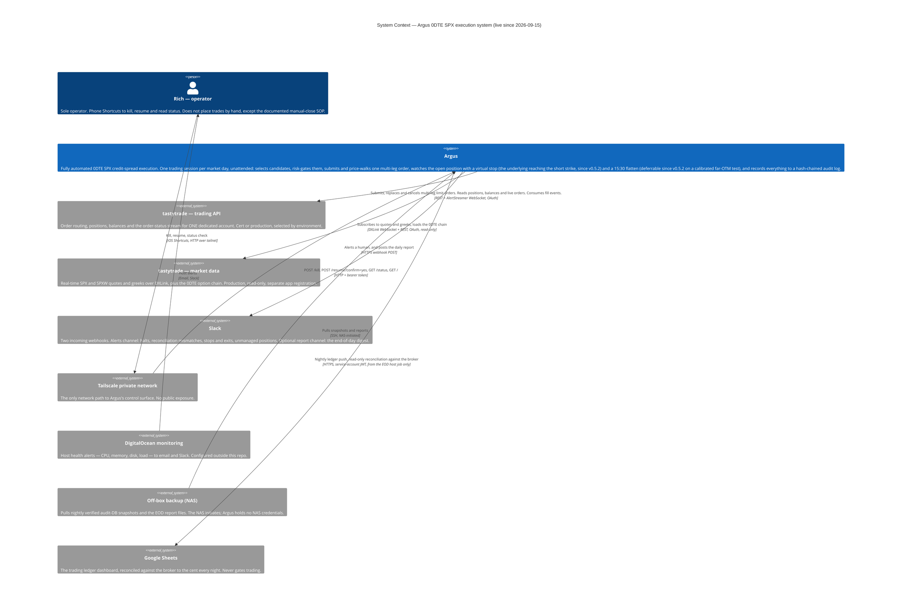

# C4 Level 1 — System Context

**Audience:** traders, compliance, executives. No code knowledge assumed.

Argus is a single always-on system that trades 0DTE SPX credit spreads on **one dedicated
tastytrade account**, live since 2026-09-15 at minimum size, with no human in the loop for
entries or exits. This diagram deliberately shows Argus as one opaque box: the only things
worth knowing at this level are *who* can act on it, *what* it depends on, and *where* a
human is told something. The human interactions that matter operationally are two: the
**kill switch** (stop taking new risk, one tap from a phone) and its only counterpart,
**resume** (a deliberate, confirmed request to allow entries again).

Three details on this diagram are load-bearing rather than internal. First, Argus holds
**two separate tastytrade sessions** on two app registrations: a trading session whose
world (cert or production) follows the configured `environment`, and a *read-only*
market-data session on production quotes (`broker/session.py`, `SessionRole`). Second, the
traded account is **dedicated** to Argus — every account-level number it reads (positions,
net liquidation value, day P&L) is treated as Argus-only, so a foreign position would make
reconciliation halt the process. Third, every human-facing surface is bound to a private
Tailscale address and requires a bearer token; nothing Argus serves is on the public
internet.

## What each external dependency is used for

| External system | Source of truth | Notes |
|---|---|---|
| tastytrade trading API | `broker/session.py`, `execution/broker.py`, `account/rest.py`, `account/stream.py`, `account/refresher.py` | **The only source of truth for positions and orders.** Argus refuses to resume on any mismatch with its own records (`reconcile.py`). Credentials are `TASTYTRADE_TRADING_CERT_*` / `TASTYTRADE_TRADING_LIVE_*`; which slot is used follows `environment`, and a `live` profile refuses to start without its own slot or with one holding the cert values. The account is pinned by `[broker] account_number`, which `config.py` requires under `live`. |
| tastytrade market data | `marketdata/dxlink.py`, `signal/live_chain.py` | `TASTYTRADE_MARKETDATA_LIVE_*`, its own registration. `TastytradeSession.trading_session` raises if asked for a market-data session, so nothing that can move money can hold the production-quote one. |
| Slack | `notify.py` (alerts), `scripts/argus-eod.sh` (report) | Optional. A missing `ARGUS_SLACK_WEBHOOK_URL` degrades alerting to the log and never refuses startup. `ARGUS_REPORT_SLACK_WEBHOOK_URL` routes the EOD digest to its own channel and falls back to the alerts webhook. |
| Tailscale | `config.py` `[server] bind_host`, `docker-compose.yml` `network_mode: host` | Argus binds exactly one listening socket, on the tailnet address. A wildcard bind is a `ConfigError`. |
| DigitalOcean monitoring | `CLAUDE.md` (deployment section) | > **Unverified from source:** configured in the DO control panel; no code or config in this repo defines these alert policies. |
| NAS backup | `scripts/argus-snapshot.sh`, `scripts/argus-pull*.sh`, `argus-snapshot.timer`, `argus-pull-check.timer` | The whole off-box durability story — Litestream is deferred past go-live by decision. `argus-pull-check` watches both ends of the pull and pages if either goes stale. |
| Google Sheets | `tools/ledger.py`, `tools/broker_ledger.py`, `tools/sheets.py`, `tools/rs256.py`, `scripts/argus-eod.sh` | Since v0.4.7 (2026-09-22). Service-account auth (OAuth was tried and abandoned the same day — an External app cannot leave "Testing" without a domain and a privacy policy). Read-only against the audit DB, runs in its own throwaway container as the EOD job's last two steps. **Can never gate trading** — an AST test pins that it cannot reach the submission path. |

## What is deliberately *not* on this diagram

- **No broker-side stop orders.** Argus never sends a stop-market order, and never uses the
  broker's complex-order API (OCO/OTO). Exits are a virtual stop evaluated in-process and
  routed as a walked limit order, escalating at most to a single market-crossing **limit**
  capped at the spread width (`execution/watchdog.py`).
- **No web UI.** The operator surface is a JSON endpoint and a single dependency-free HTML
  page (`status.py`), reachable only over the tailnet.
- **No second Argus.** Exactly one process may write a given audit database; a second one
  refuses to start (`db/lock.py`).
- **No shared account.** Cash moving in or out of the traded account during a trading day is
  read as P&L by the daily-loss breaker, and any position Argus did not place hard-halts the
  first reconcile. Both are operating rules, stated in `CLAUDE.md`, not code paths.
