# C4 Level 2 — Containers

**Audience:** infrastructure/DevOps and architects. Answers "what actually runs, where does
state live, and what talks to what".

Argus is deliberately **one trading process**. Spec §4 requires a single persistent
`asyncio` process sharing one event loop — market data ingestion, the signal loop, the
position watchdog and kill-switch responsiveness all live in it, because a watchdog that
reacts late is the one failure this system cannot afford. So the interesting boundaries
are not process boundaries. They are the **writer lock** on the database, the
**Tailscale-only bind** of the control surface, the **profile** that decides which config
file and which database the process opens, and the **two supervision layers** (Docker
restart + systemd restart) that cover different failures.

Around that one process sit three **one-shot host jobs** on systemd timers — the nightly
snapshot, the NAS pull check, and (since v0.4.4) the end-of-day report. Each runs a
throwaway container from the same image with `docker compose run --rm`, opens the database
**read-only**, and takes no lock, so none of them can stop or block the trading process.

The HTTP listener is drawn as its own box because it has its own protocol, its own
authentication boundary and its own lifetime — it binds **before** reconciliation and
stays up nights, weekends, between sessions and **while the process is halted** — but it
is `asyncio.start_server` inside the supervisor, not a separate deployable
(`control.py`, deliberately stdlib rather than a web framework).

```mermaid
%%{init: {"c4": {"useMaxWidth": false}}}%%
C4Container
    title Container view — Argus on a DigitalOcean droplet (profile = live)

    Person(operator, "Rich — operator", "Phone on the tailnet")

    System_Ext(tt, "tastytrade APIs", "REST /orders + /accounts, DXLink quote stream, AlertStreamer order and position stream")
    System_Ext(slack, "Slack webhooks", "alerts + EOD report, HTTPS POST")
    System_Ext(nas, "NAS", "pulls /path/to/backups over SSH")
    System_Ext(sheets, "Google Sheets", "the trading ledger dashboard; service-account auth, signed with tools.rs256, ~50 stdlib lines")

    Enterprise_Boundary(droplet, "DigitalOcean droplet (ET timezone)") {

        Container(hostenv, "/etc/argus/host.env", "root-owned 600, per host, not in git", "ONE line, ARGUS_ENV=live. Selects the profile. The live cutover WAS this file changing, and the rollback is the same line.")
        Container(systemd, "argus.service", "systemd unit, EnvironmentFile=host.env", "Runs 'docker compose up' in the foreground. Restart=always. Second supervision layer.")
        Container(timers, "Host jobs", "systemd timers, oneshot", "argus-snapshot 16:30 ET, argus-eod 16:45 ET, argus-pull-check 09:00 ET. Each runs 'docker compose run --rm' against the same image, READ-ONLY, no lock. Since v0.4.7 argus-eod.sh's last two steps run tools.ledger then tools.sheets push.")
        Container(deploy, "argus-deploy.sh", "operator-run script", "Checks out a tag, builds with ARGUS_VERSION, classifies the release, restarts only when the container can see the change, then reads version AND config fingerprint back from the journal.")

        Container_Boundary(compose, "docker compose service 'argus' (network_mode host, restart unless-stopped)") {
            Container(supervisor, "Argus supervisor", "Python 3.12, asyncio, one process", "python -m argus. app.Application: process-lifetime rails plus a SessionScheduler that runs ONE session per ET trading day. Owns the event loop for the signal loop, watchdog, streams and control server.")
            Container(control, "Control server", "stdlib asyncio.start_server, in-process", "POST /kill, POST /resume?confirm=yes, GET /status (JSON), GET / (HTML). Bearer token ARGUS_KILL_TOKEN, constant-time compare, auth before routing.")
        }

        ContainerDb(db, "argus-live.db (and argus.db)", "SQLite WAL on the argus-state volume", "Hash-chained audit_log plus positions, orders and order_legs (migrations 0001 to 0005). argus-live.db is the traded account's chain. argus.db is the finished cert chain, kept beside it. A profile's db_path picks one.")
        Container(lockfile, "<db_path>.lock", "flock advisory lock file", "SAFETY RAIL. Exclusive non-blocking flock taken before the DB opens. A second writer refuses to start rather than collide on audit seq.")
        Container(config, "argus.live.toml + blackout_dates.txt", "bind-mounted read-only", "The ACTIVE profile only, mounted under its own filename so the loader can check filename against the environment key. No config is baked into the image.")
        Container(secrets, ".env", "env_file, root-owned 600", "TASTYTRADE_ROLE_WORLD credential slots for both trading worlds at once, ARGUS_KILL_TOKEN (required), Slack webhooks (optional).")
        Container(sheetskey, "google-key.json + settlements.csv", "root-owned, bind-mounted read-only, ledger run only", "A Google SERVICE ACCOUNT key (OAuth was tried and abandoned the same day) mounted ONLY into the tools.sheets push step, never into the trading process. settlements.csv is an optional persistent override for a held-to-expiry settlement print.")
        Container(backups, "/path/to/backups", "host directory", "Verified nightly snapshots and EOD report files. Deliberately outside the volume so 'compose down -v' cannot take them.")
    }

    Rel(hostenv, systemd, "ARGUS_ENV", "EnvironmentFile")
    Rel(systemd, supervisor, "starts, restarts, stops", "docker compose")
    Rel(operator, control, "kill, resume, status", "HTTP + bearer, Tailscale IP only")
    Rel(supervisor, control, "hosts on the same event loop", "in-process")

    Rel(supervisor, lockfile, "flock BEFORE opening the DB", "fcntl")
    Rel(supervisor, db, "one writer connection. Tier 1 awaited, Tier 2 queued", "sqlite3 via to_thread")
    Rel(supervisor, config, "loads at startup, fail-closed", "tomllib")
    Rel(supervisor, secrets, "credentials + kill token", "environment")
    Rel(supervisor, tt, "orders, account state, quotes, chain", "REST + WebSocket, OAuth")
    Rel(supervisor, slack, "alerts, never blocking the loop", "HTTPS POST from a worker")

    Rel(timers, db, "online backup + verify_chain, EOD sections, ledger rebuild", "sqlite3 mode=ro")
    Rel(timers, backups, "writes snapshots, reports and ledger CSVs", "file")
    Rel(timers, slack, "EOD digest, pull-check page, ledger failure warning", "curl")
    Rel(timers, sheetskey, "reads the service-account key + settlement overrides", "bind mount, ledger step only")
    Rel(timers, sheets, "pushes the ledger's data tabs, replaced in full", "HTTPS, RS256-signed JWT")
    Rel(nas, backups, "pulls", "SSH")
    Rel(deploy, systemd, "restart when needed", "systemctl")

    UpdateRelStyle(operator, control, $offsetY="-40")
    UpdateRelStyle(supervisor, lockfile, $offsetX="-70")
    UpdateRelStyle(supervisor, db, $offsetY="20")
    UpdateRelStyle(supervisor, tt, $offsetX="30", $offsetY="-20")
```

## Safety-rail boundaries on this diagram

These are the operationally important edges. Everything else can fail and be restarted;
these change what the system is allowed to do.

| Rail | Where it lives | What it guarantees |
|---|---|---|
| **Kill switch** | `control.py` `POST /kill` → `risk/killswitch.py` | Stops **new risk** in one phone tap: the gate, `EntryExecutor.submit`'s re-check, and an **entry** walk in flight (aborted and cancelled within one `cycle_wait_s`). Alerts Slack from inside `engage`. 200 only after the Tier 1 `kill_switch.trip` is durable; 500 `{"audit":"write_failed"}` if not — the halt stands either way. Deliberately does **not** stop exits, the watchdog, the flatten or the process. |
| **Kill switch persistence** | `risk/kill_state.py`, read in `Application.startup` | The switch is rebuilt from the audit log: engaged iff the newest `kill_switch.trip` has no `kill_switch.resume` at a higher `seq`. No date bound, no expiry; an unreadable state fails CLOSED to engaged. A restored start pages `kill_switch_restored` once. |
| **Resume** | `control.py` `POST /resume?confirm=yes` → `KillSwitch.disengage` | The ONE clear in the system (AST-pinned). Records BEFORE it flips, so a failed write leaves the switch engaged. Reports `restart_required` when the process also holds a `HaltRecord`, which a resume cannot lift. |
| **Halt grade** | `app.Application._halt_process`, `reconcile.halt_grade` | `ALL` (default) parks the process: no sessions, `/status` and `/kill` still served. `ENTRIES` keeps the scheduler, watchdog, exits and flatten running with no entry hook. Grade only ever tightens. |
| **Daily-loss circuit breaker** | `risk/breaker.py` in `PreTradeGate`, `risk/rehydrate.py` | Trips on day P&L with no human step and latches **per trading date**: a same-day restart rehydrates the trip and the original NLV anchor from the audit log; a new day starts clean; an unreadable state halts. |
| **Daily loss budget** | `risk/loss_budget.py`, `risk/gate.py` (`daily_loss_budget_exceeded`) | A fourth, non-latching rail on the whole DAY (since v0.4.6, 2026-09-21): refuses new size past `daily_max_loss − (today's realized loss + everything open's worst case)`. Every unreadable input is ZERO budget; never engages the kill switch. |
| **Side balance** | `risk/side_balance.py`, `risk/gate.py` (`side_imbalance_exceeded`) | Since v0.5.2 (2026-09-26): refuses an entry that would leave `\|puts − calls\| > risk.max_side_imbalance`, counted per side the same way the concurrency cap counts in total. An unreadable side counts as its own worst-case entry (v0.5.3). |
| **Far-OTM flatten deferral** | `execution/flatten_deferral.py`, gated by `watchdog.flatten_deferral` | Since v0.5.2 (2026-09-26): may only ever REMOVE a `FLATTEN_BEFORE_CLOSE` send on a calibrated insurance test, never add one; refuses to load `"on"` unless the welded size invariant holds. |
| **Single writer, enforced** | `db/lock.py` | Two processes writing one audit chain silently collide on `seq`. The lock makes that a refusal to start. |
| **Fail-closed audit log** | `audit/log.py` → `Application._halt_on_audit_failure` | A failed write latches the log failed, engages the kill switch and halts `ALL`. No auto-retry. |
| **Reconciliation** | `reconcile.py`, at process start and at every session start | Broker is the only source of truth. Sandbox/live halt on a mismatch (graded); shadow aborts only the day. An unreachable broker is retried on the `[reconcile]` budget, then parks the process at start or aborts the day per session. |
| **Profile + filename check** | `config.py`, `docker-compose.yml`, `host.env` | There is no default config path. `ARGUS_ENV` names the file; the file's own `environment` key is the authority, and the loader refuses when the two disagree. `live` refuses without `audit.synchronous = FULL/EXTRA` and without `[broker] account_number`. |
| **Tailscale-only bind** | `config.py` `[server]`, `network_mode: host` | A wildcard bind is a `ConfigError`; a failed bind refuses startup rather than widening. |

## Communication summary

| From → To | Protocol | Sync/async | Auth boundary |
|---|---|---|---|
| Phone → control server | HTTP/1.1, `Connection: close` | request/response, ≤10s read timeout | Bearer token, constant-time compare; 401 before any routing. `/resume` additionally needs exactly one `confirm=yes`. |
| Supervisor → tastytrade REST | HTTPS | async (httpx inside the SDK), every order request through one process-wide rate governor (`ratelimit.py`) | OAuth, per-role session; `is_test` derived from `environment` |
| Supervisor → account liveness REST | HTTPS | sync client on a dedicated single-worker thread (`account/refresher.py`), never the event loop | OAuth bearer token re-read per dispatch |
| Supervisor → DXLink | WebSocket | async push, one owning task with reconnect/resubscribe | OAuth (market-data registration) |
| Supervisor → AlertStreamer | WebSocket | async push (`on_order` → `FillConsumer`) | OAuth (trading registration) |
| Supervisor → Slack | HTTPS POST | enqueued, POSTed from a worker; coalesced per `(kind, scope)`; never blocks, never raises | Webhook URL *is* the credential; redacted in logs |
| Supervisor → SQLite | file I/O | Tier 1 awaited via `to_thread`, Tier 2 through a bounded queue | flock-guarded, one connection, shared by the order store via `AuditLog.write` |
| Host jobs → SQLite | file I/O | one-shot, `mode=ro` | none — read-only, no lock |
| Host jobs → Google Sheets | HTTPS | one-shot POST from `tools.sheets push`, `argus-eod.sh`'s last step | Service-account JWT, RS256-signed by `tools/rs256.py` (~50 stdlib lines pinned against `openssl`); OAuth was tried and abandoned (an External app cannot leave "Testing" without a domain and a privacy policy) |

## Deployment notes that change behaviour

- **`network_mode: host` is required, not convenience.** The control server binds the
  droplet's Tailscale IP, which lives in the host network namespace.
- **Config is bind-mounted and profile-named, so it does not roll back with the image
  tag.** `/status` and the first journal line carry a config FINGERPRINT —
  `(profile, filename, sha12)` — beside the build `version`, and `argus-deploy.sh` reads
  both back after every restart. The image carries no `ARGUS_CONFIG` and no baked config,
  deliberately: either would silently win over, or stand in for, a drifted mount.
- **Every compose command needs `ARGUS_ENV`** (`${ARGUS_ENV:?}` — no default), including
  `build`, `run`, `ps` and `down`, and `sudo` scrubs the environment, so it goes on sudo's
  own command line. The three host jobs read it from `host.env` via `EnvironmentFile=`.
- **Only the active profile's config is mounted.** Reading the cert chain (`argus.db`)
  from the live droplet needs an explicit `-v` mount (runbook §8).
- **`WORKDIR /data`** exists because `audit.db_path` is CWD-relative; anything run from
  another directory inside the container silently opens a second, empty database.
- **`python -m argus` reads `ARGUS_ENV` / `ARGUS_CONFIG_DIR` / `ARGUS_CONFIG`; every
  `argus.tools.*` REQUIRES `--config`.** Neither has a default any more — the default was
  the mechanism of the 2026-07-21 incident that wrote dev records into a production chain.
- **A release is classified by what the container can reach** — the image, the two bind
  mounts, the `argus.service` unit — and nothing else restarts the trading process.
  `scripts/`, `docs/`, `tests/`, the host-job units and another profile's config are inert.
- **The ledger's Google credential is mounted nowhere the trading process runs.**
  `google-key.json` and `settlements.csv` are read-only bind mounts scoped to the
  `argus-eod.sh` ledger/push steps alone (`docker compose run --rm`, throwaway
  container) — `argus.service`'s long-running `docker compose up` never sees either
  file, and an AST test pins that the ledger/Sheets code path cannot reach
  `pipeline.trades_for_real`.
