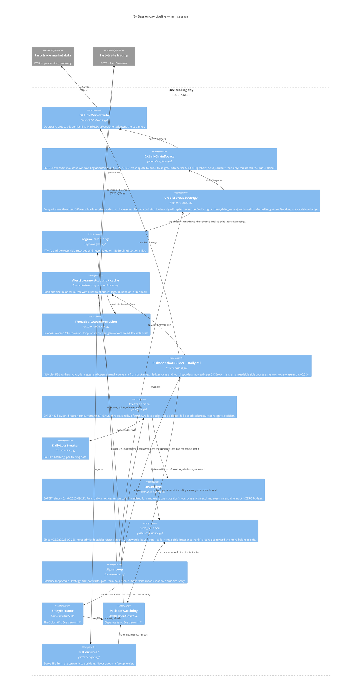
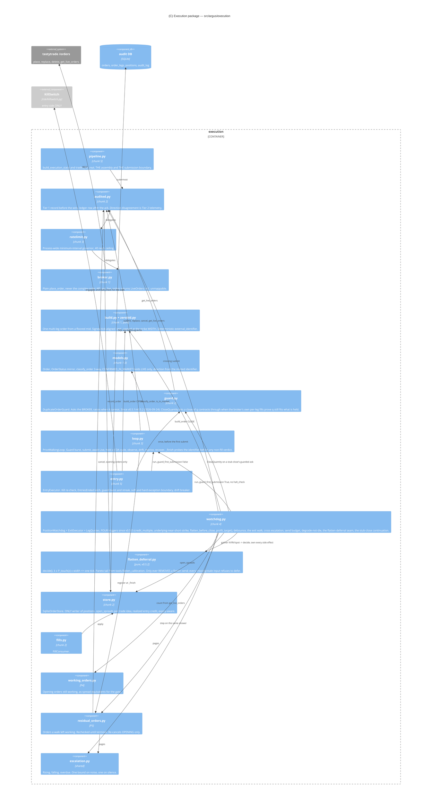

# C4 Level 3 — Components of the Argus supervisor

**Audience:** dev leads. Answers "what is inside the one process, and which way do the
dependencies point".

The supervisor decomposes into three **lifetimes**, and that split is the single most
useful thing to understand about the internal structure:

- **Process lifetime** — built once by `Application.startup()` and alive across trading
  days, nights, weekends and halts: the audit log, the kill switch (rehydrated from the
  log), the control server, the status service, the heartbeat, the notifier, the scheduler.
- **Session-day lifetime** — rebuilt for each trading day by
  `Application._run_session_day` and `session.run_session`: the daily-loss breaker and
  day-P&L anchor (rehydrated per trading DATE), the pre-trade gate, both broker sessions,
  the market-data and account streams, the chain, the signal loop.
- **Trading side** (`session.TradingSide`) — exists only when
  `pipeline.trades_for_real(config)` is true, i.e. sandbox and live: the execution stack,
  the entry executor, the position watchdog with its exit executor, the fill consumer and
  the residual-order recheck. **Built together or not at all** — a watchdog without the fill
  consumer would watch a `positions` table nobody writes.

Three corrections to the shape one might expect. First, **price-walking is not the exit
path**: `execution/loop.py` is *one* state machine used by both entry and exit,
parameterized by `WalkPolicy.for_entry` / `for_exit`; the exit-specific logic (when to
close, the flatten, the market-crossing price) lives in `execution/watchdog.py`. Second,
**reconciliation is not restart-only**: the same `reconcile_with_retry` →
`reconcile_and_record` sequence runs at process start and at every session start, and the
two sites differ only in how they refuse. Third, **the kill switch has a deliberately
one-sided blast radius**: it is handed to the entry executor and to nothing on the exit
side, so a halt can never cancel the order closing a position.

The component view is drawn in three diagrams rather than one, because one diagram with
forty boxes renders as noise: **(A)** the process layer and its safety rails, **(B)** one
trading day's pipeline, **(C)** the execution package.

## (A) The process layer and its safety rails

Everything here outlives a trading day. The arrows into `Application` from below are the
**halt seams** — every component that can decide the process must stop trading calls back
into `_halt_process`, which is the one place a halt is graded, latched, announced and (for
`ALL`) turned into a stop.

```mermaid
%%{init: {"c4": {"useMaxWidth": false}}}%%
C4Component
    title (A) Process layer — built once by Application.startup

    Person(operator, "Operator", "phone on tailnet")
    System_Ext(slack_ext, "Slack", "webhook")
    System_Ext(tt, "tastytrade", "trading REST, short-lived at startup")

    Container_Boundary(proc, "Argus supervisor process") {
        Component(cfg, "Config loader", "config.py", "Fail-closed TOML, selected by PROFILE with no default. Refuses a filename-environment mismatch, live without FULL fsync, live without account_number.")
        Component(app, "Application", "app.py", "Startup order, the scheduler drive, the park. Owns _halt_process: engage, latch a HaltRecord with a GRADE, announce once, and request_stop only for ALL.")
        Component(lock, "DatabaseLock", "db/lock.py", "SAFETY. Exclusive flock before the DB opens.")
        Component(audit, "AuditLog", "audit/log.py", "SAFETY. Hash chain. Tier 1 awaited, Tier 2 queued. read/write are THE gateway to the one writer connection. A failed write latches and fires on_failure.")
        Component(killstate, "Kill state reader", "risk/kill_state.py", "SAFETY. Engaged iff the newest trip has no later resume by seq. No date bound. Unreadable fails closed.")
        Component(ks, "KillSwitch", "risk/killswitch.py", "SAFETY. engage flips then alerts then records. disengage records then flips. Owns no stop event.")
        Component(ctl, "ControlServer", "control.py", "SAFETY. POST /kill, POST /resume, GET /status, GET /. Bearer auth before routing. Binds BEFORE reconciliation.")
        Component(stat, "StatusService + SessionStatus", "status.py", "ONE assembly to JSON and HTML. Reads live objects for current state and the DB for history.")
        Component(hb, "LoopHeartbeat", "heartbeat.py", "Event-loop lag warning. Its trip hook is config-gated and ships off.")
        Component(notify, "SlackNotifier + AlertFn", "notify.py, alerts.py", "Enqueue-only, worker POST, never raises. Throttled per kind and per position scope.")
        Component(sched, "SessionScheduler + MarketCalendar", "scheduler.py, marketcalendar.py", "One session per ET trading day. Half-day aware. Bridges the process stop to the session stop.")
        Component(recon, "Reconciler", "reconcile.py", "SAFETY. Positions AND orders vs broker, incl. unmappable orders. Retry on unreachable. mismatch_halts_process and halt_grade are the two boundaries.")
        Component(rehydrate, "Day-risk rehydration", "risk/rehydrate.py", "SAFETY. Reads today's breaker trip and FIRST anchor back, so a same-day restart cannot re-arm the budget.")
        Component(sess, "Session body", "session.py run_session", "One trading day. See diagram B.")
    }

    Rel(operator, ctl, "kill, resume, status", "HTTP + bearer")
    Rel(ctl, ks, "engage, disengage")
    Rel(ctl, stat, "assemble")
    Rel(stat, audit, "read")
    Rel(app, cfg, "loads")
    Rel(app, lock, "acquire first")
    Rel(app, audit, "builds, sets on_failure")
    Rel(app, killstate, "load_kill_switch_state")
    Rel(killstate, audit, "read trip and resume rows")
    Rel(app, ks, "builds engaged or not, engages via _halt_process")
    Rel(app, ctl, "builds and binds")
    Rel(app, hb, "builds")
    Rel(app, notify, "resolves the AlertFn")
    Rel(app, recon, "process-start reconcile, retried then PARKED")
    Rel(recon, tt, "positions + live orders")
    Rel(app, sched, "drives unless halted ALL")
    Rel(sched, app, "_run_session_day")
    Rel(app, rehydrate, "per trading date")
    Rel(app, sess, "runs with halt and halted_grade seams")
    Rel(ks, notify, "alert on every trip")
    Rel(ks, audit, "kill_switch.trip / resume")
    Rel(audit, app, "on_failure: halt ALL")
    Rel(sess, app, "halt seam: mismatch, post-submit entry failure, watchdog degraded")
    Rel(notify, slack_ext, "alerts", "HTTPS")
```

## (B) One trading day's pipeline

`run_session` is THE pipeline body — `tools.shadow` reuses it through
`Application.run_single_session`, so it never lives in two places. The order is the safety
order: log in (ban-aware retry), build the execution stack, **reconcile**, then market data,
the fill consumer (wired before the account stream starts delivering), the account stream,
the chain, the risk snapshot, the trading side, and finally the signal loop.

## (C) The execution package

The order path is a decorator stack, and the nesting is load-bearing: **audit outermost,
throttle inside, adapter innermost** (`pipeline.build_execution_stack`, pinned by a test).
Audit outside means the Tier 1 "about to send" record is durable regardless of how long the
wire waits for a rate-limit slot; throttle inside means the one process-wide governor covers
every order request, including the guard's and the watchdog's reads.

## Safety-critical path vs. signal/execution logic

The distinction that matters when changing code here: a bug in the left column can cost a
trade; a bug in the right column can cost the account.

| Signal / execution mechanics | Safety-critical (fail-closed, refuses rather than guesses) |
|---|---|
| `signal/strategy.py` + `signal/implied.py` — candidate selection (mid-implied short-strike delta) | `risk/killswitch.py` + `risk/kill_state.py` — halts new entries; durable; cleared only by `/resume` |
| `signal/live_chain.py`, `signal/contracts.py` — chain assembly | `risk/breaker.py` + `risk/rehydrate.py` — latching daily max-loss, per trading date |
| `signal/regime.py`, `signal/realized.py` — telemetry only | `risk/gate.py` — kill switch, breaker, spread-counted concurrency, three size rails, staleness |
| `marketdata/dxlink.py`, `marketdata/book.py` — quote ingest | `staleness.py` — the ONE fail-closed staleness rule (NaN and negative ages are stale) |
| `orchestrator.py` — cadence and sizing arithmetic | `execution/guard.py` — the only duplicate-submission backstop; raises rather than allowing |
| `execution/build.py`, `execution/zerobid.py` — construction and tick floor | `execution/watchdog.py` — the virtual stop, the flatten, degrade-not-die |
| `execution/loop.py` — cadence, sequencing, the reprice ladder | `execution/residual_orders.py` — the "already working" half of the kill switch's promise |
| `execution/ratelimit.py` — request governor (insurance, not cadence) | `reconcile.py` — broker-is-truth; refuses to resume on mismatch or on an unreadable order |
| `status.py`, `notify.py` — read-only rendering, best-effort alerting | `audit/log.py` + `db/lock.py` — one writer, and a failed write halts trading |
| `account/refresher.py` — liveness plumbing | `control.py` — authenticated halt surface; 200 only after the trip is durable |
| `occ.py` — the one OCC symbol parser (`None` means cannot say, and every caller fails closed; `occ_right` added v0.5.3 for the side count) | `config.py` — no default path, profile/filename check, live-only refusals, refuses `flatten_deferral = "on"` without the welded invariant |
| `execution/flatten_deferral.py` — pure arithmetic, no I/O | `risk/side_balance.py`, `risk/loss_budget.py` — refuse an entry that would unbalance the book or exceed the day's remaining budget |
| `tools/ledger.py`, `tools/sheets.py`, `tools/settlement.py` — nightly reporting, read-only, own container | (not safety-critical: an AST test pins that the ledger/Sheets path cannot reach `pipeline.trades_for_real`) |

A heuristic that holds across the codebase: **safety-critical components turn "I cannot
tell" into a refusal, not into permission.** `DuplicateOrderGuard` raises when the broker is
unreachable; `LegQuotes` returns a resolution stating *why* it failed rather than a bare
`None`; `classify_order` treats "the broker never reported quantities" as FILLED; `is_stale`
treats NaN as stale; an unreadable kill-switch state restores ENGAGED; an unreadable
day-risk state halts; a broker answer that does not name the abandoned order refuses the
cross.

## Structural rules enforced by tests, not convention

- `loop.py` takes **no `MarketDataPort`** and imports only tick arithmetic from `zerobid`:
  the reprice ladder is deterministic from the gate-approved mid and never re-quotes. Its
  floor is clamped to the strike width read off the order's own OCC symbols
  (`Order.width`), so the walk stays market-free.
- `loop.py` **never imports `watchdog.py`** (`tests/test_watchdog.py`); the exit is a
  `WalkPolicy`, not a second implementation.
- `ExitExecutor` arms **no `halt_check`** and holds **no kill-switch reference**
  (`tests/test_kill_scope.py`).
- `KillSwitch.disengage` has exactly **one caller** in `src/` — `POST /resume`.
- Nothing submits outside `pipeline.trades_for_real`; the complex-order API appears nowhere
  in `src/`.
- `_ASK_BEFORE_CONCLUDING | _NEVER_ASKS == set(WalkOutcome)`, disjoint
  (`test_every_outcome_is_classified`); `EntryExecutor._report`'s table covers the whole
  enum (`test_the_outcome_table_is_the_whole_enum`).
- The `/status` seam converters in `session.py` name every field of their source type
  (`tests/test_session_status_seams.py`), because an under-copy between two dataclasses with
  `None` defaults is silent at every layer.
- `flatten_deferral.py` and `side_balance.py` are pure — no clock read, no config read, no
  I/O — the same contract `signal/regime.py` and `signal/realized.py` already hold, so their
  decision logic is testable without a watchdog or a gate.
- A profit-target take that does not FILL may never touch `_attempted`, `_sends` or
  `_flatten_attempted` (AST-pinned) — a failed take must cost the position nothing.
- The per-side counts in `risk/snapshot.py` are AST-pinned to come from trade ideas, never a
  bare broker-leg symbol count (CLAUDE.md's fourth landmine, extended to the side rule).
