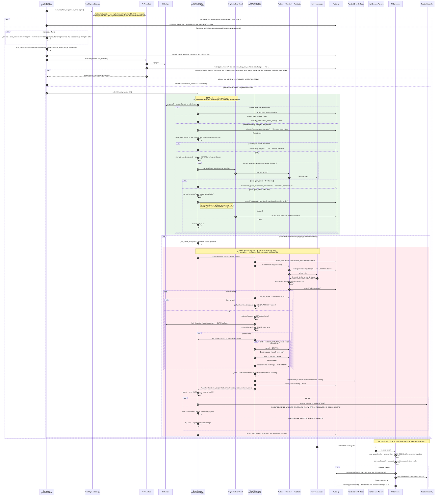
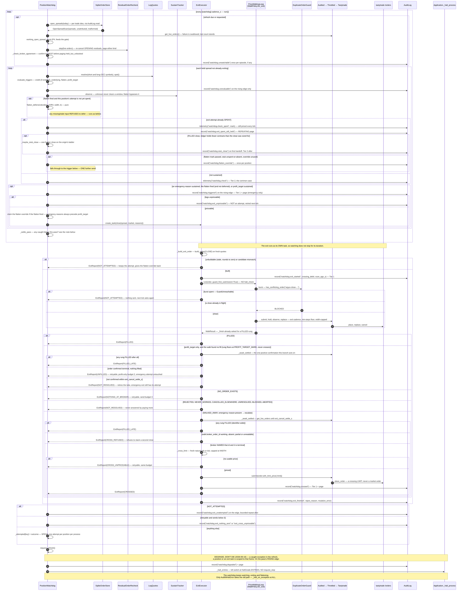
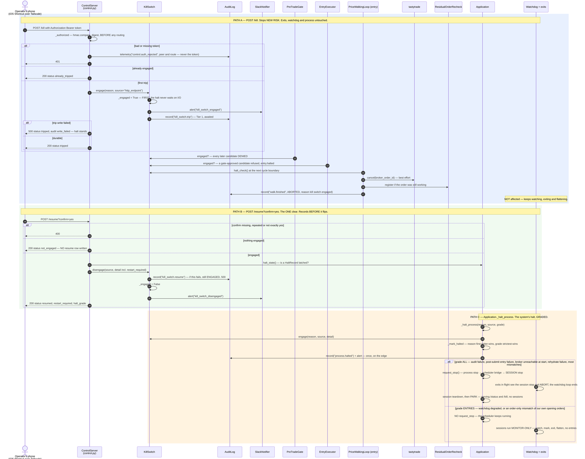
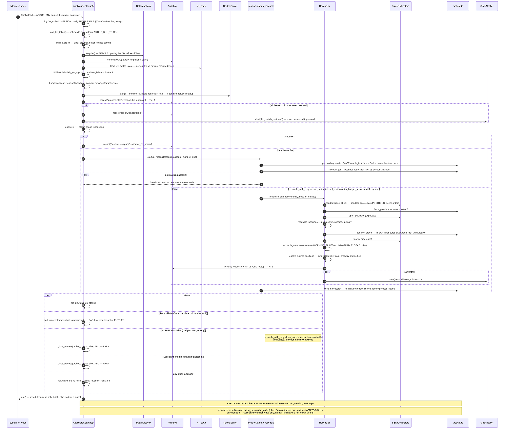

# UML sequence diagrams — how operations actually execute

**Audience:** engineers implementing or debugging these flows. Every participant is a real
class or module and every message is a real call. Anchors are `module::function`, not line
numbers.

**Read this first:** in `environment = "shadow"` only flow 1's first half runs, and it
terminates at `shadow.would_submit`. Flows 1 (from `EntryExecutor` onward) and 2, and the
sandbox/live half of flow 4, require `pipeline.trades_for_real(config)` to be true — which
it is on the droplet since the 2026-09-15 live cutover. A **monitor-only** day (a halt at
`HaltGrade.ENTRIES`, or an entries-ended day) runs flow 2 in full and flow 1 up to the gate.

---

## 1. Entry execution — signal to fill

`SignalLoop.evaluate_once` runs every `[signal] cadence_s`. The terminal action is the only
thing `environment` changes: `submit=None` (shadow, or monitor-only) logs
`shadow.would_submit` or nothing; otherwise `EntryExecutor.submit` is called.

Three boundaries are worth internalising before reading the diagram:

- **The exception boundary is one call.** Everything in `EntryExecutor.submit` is *soft* —
  nothing has been sent, so an unexpected failure ends today's **entries** (not the day,
  not the process: the `EntriesEnded` latch, 2026-09-01). Everything from
  `_walk_and_report` onward is *hard* — an order may exist, so any exception halts the
  process at `HaltGrade.ALL`.
- **The duplicate guard is asked once, above the boundary, in a bounded burst.** A spent
  burst retires the trade idea; only `execution.guard_unreachable_max_streak` spent bursts
  in a row (distinct trade ideas) end the day's entries. The walk is never reached without
  an answered `ConflictVerdict`.
- **The fill that books the position does not come back through this call chain.**
  `WalkResult` is a report. Positions are written by `FillConsumer` off the `AlertStreamer`
  push, independently of who submitted.

**Source anchors:** `orchestrator.py::SignalLoop.evaluate_once` / `_choose`,
`risk/side_balance.py::rank` / `admissible`, `risk/loss_budget.py::contracts_within_budget`,
`signal/implied.py::selection_delta`, `risk/gate.py::PreTradeGate.evaluate`,
`entry.py::EntryExecutor.submit` (soft region), `entry.py::_check_for_duplicate`,
`entry.py::_guard_unreachable`, `entry.py::_end_entries_today`, `entry.py::_walk_and_report`
(hard region), `loop.py::PriceWalkingLoop.run` / `_walk` / `_finish` / `_register_residual`,
`audited.py::AuditedOrderExecution.submit`, `fills.py::FillConsumer.consume`,
`session.py::run_session.on_order`.

> **Unverified:** the mid-implied delta source (`signal.short_delta_source = "mid"`,
> deployed v0.4.6, 2026-09-21) has run no live session as of `f3f0211`. The pre-deploy
> replay gate (`tools.replay_selection`) passed on 10,840 recorded live legs; the first
> live tick on it is unread. → 00-index.md open item 17.

---

## 2. Exit — the position watchdog and the price-walking close

Spec §4 makes this a task independent of the signal loop: "gamma risk in the final hour
doesn't care whether entry logic is running". Each pass (every `[watchdog] cadence_s`):

1. **Refresh, when due** (`refresh_interval_s`, or on request after a fill): rebuild the
   watch list from the ledger per TRADE IDEA (`store.open_spreads`, expiry-aware), poll
   working orders for the gate's concurrency count (P4) and step the residual recheck on the
   same answer (P5), check that the broker's leg count agrees with the ledger, and report
   anything `unattributed`/`malformed`.
2. **Evaluate every held spread — including one whose exit is spent.** FOUR triggers,
   independently: `credit_multiple` (on the REALIZED entry credit, with an observable-margin
   comparison — **inert while `watchdog.credit_trigger_enabled = false`, live and cert since
   v0.5.2, 2026-09-26**), `underlying_near_short_strike` (the sole emergency exit under the
   strike-touch stop, `underlying_buffer_points = 0`), `flatten_before_close` (a clock:
   `watchdog.flatten_before_close_s` before THIS day's close, half-day aware — since v0.5.2
   this can be DEFERRED by `execution/flatten_deferral.py::decide` on a calibrated insurance
   test, never invented, only withheld), and `profit_target` (since v0.5.0, 2026-09-23: the net
   mid rounds to exactly one tick — evaluated always, ACTED on only while
   `watchdog.profit_target_enabled`, currently OFF in all three profiles). The three EMERGENCY
   triggers are debounced by `SustainTracker` (the flatten fires on first observation, unless
   deferred); the profit target's own episode ends only when its condition clears.
3. **Act** on a sustained trigger by handing an exit to its own task, unless the position's
   emergency attempt is spent — where the flatten, once past its mark, and a partial close's
   STUB (`_maybe_stub_close`, since v0.5.1/v0.5.2), each get one further send through the
   guard.

Five things here are exit-specific. The guard **is** run by the loop
(`guard_first_submission=True`), in a bounded burst whose failure becomes `NOT_ATTEMPTED`
rather than a halt (2026-09-03). A `WALKED_AWAY` walk **escalates** to one market-crossing
limit, only after the broker **positively confirms** the abandoned rung is terminal. Two
outcomes — `NOTHING_AT_BROKER` and `CROSS_UNPRICEABLE` — retry through the guard under a
3-send budget. A **profit take never crosses** — `_settle_profit_take` confirms dead and
retries under its OWN 2-send budget, spending nothing on the emergency side unless it fills.
And **nothing on this path consults the kill switch**.

**Source anchors:** `watchdog.py::PositionWatchdog.run` / `check_once` / `_check_one` /
`_refresh_if_due` / `_refresh_working_orders` / `_check_broker_agreement` /
`_flatten_may_act` / `_maybe_stub_close` / `_apply_flatten_deferral` / `_trigger` /
`_run_exit` / `_settle_pass` / `_halt_entries`, `watchdog.py::evaluate_triggers`,
`watchdog.py::at_profit_target`, `watchdog.py::SustainTracker`,
`watchdog.py::ExitExecutor.close` / `_after_walk` / `_cross` / `_settle_profit_take` /
`_await_settled` / `_cross_limit`, `execution/flatten_deferral.py::decide`,
`guard.py::CloseQuantity`, `residual_orders.py::ResidualOrderRecheck.step`.

> **Unverified:** the `profit_target` branch and the stub-close branch are drawn from
> source and their unit tests; neither has fired in a live session as of `f3f0211`
> (2026-09-27) — `profit_target_enabled` is `false` in every profile, and the stub
> precondition has never been observed live. → 00-index.md open items 15–16.

---

## 3. Kill switch, resume, and the internal halts

The kill switch is the operator's rail; `Application._halt_process` is the system's. They
share `KillSwitch.engage` and nothing else, and the difference is the design:

| A phone `/kill`… | …and why |
| --- | --- |
| **Denies new entries at the gate**, immediately | `PreTradeGate.evaluate` reads `engaged`. |
| **Refuses a candidate the gate already approved** | `EntryExecutor.submit` re-checks; records `entry.halted`. |
| **Abandons an ENTRY walk in flight and cancels its order** | The walk's `halt_check`, at the cycle boundary, bounded by one `cycle_wait_s`. `ABORTED` never adds a broker round trip. |
| **Leaves the cancel's outcome to P5** | If the cancel fails or sticks, the order is a registered residual and is re-cancelled until terminal. |
| **Alerts Slack, once, for every trip** | Inside `KillSwitch.engage`, the one funnel every trip source passes through. |
| **Survives a restart** | Rebuilt from the audit log at startup (`risk/kill_state.py`); no expiry, no date bound. |
| **Does NOT touch exits, the watchdog, the flatten, or the process** | `ExitExecutor` holds no kill-switch reference. `/status` stays up. |

`POST /resume?confirm=yes` is the only way back, and it is the only route in the system that
*enables* risk — so it records before it flips, and reports honestly when a `HaltRecord`
means the process will not trade again until restarted anyway.

**Halt sources and their grades**, as wired today:

| Source (`source=`) | Caller | Grade |
|---|---|---|
| `http_endpoint` | `control.py::_kill` | none — the switch alone, no `HaltRecord` |
| `heartbeat` | `app.py::_trip_on_stall` (config-gated, ships off) | none — the switch alone |
| `audit_log` | `app.py::_halt_on_audit_failure` | `ALL` |
| `reconciliation_mismatch` | `app.py::startup`, `session.py::_reconcile_or_abort` | `reconcile.halt_grade(result)` — `ENTRIES` only for our own working opening orders with no position discrepancy |
| `broker_unreachable` | `app.py::startup` after the `[reconcile]` budget | `ALL` (parks) |
| `day_risk_rehydrate` | `app.py::_run_session_day` | `ALL` |
| `entry_execution_exception` | `entry.py::_walk_and_report` | `ALL` |
| `watchdog_exception` | `watchdog.py::_halt_entries` (degrade) | `ENTRIES` |
| `watchdog_exception` | `watchdog.py::_halt_on_exception` (`AuditWriteError` only) | `ALL` |

**Source anchors:** `control.py::ControlServer._kill` / `_resume` / `_authorized`,
`killswitch.py::KillSwitch.engage` / `disengage`, `risk/kill_state.py::load_kill_switch_state`,
`gate.py::PreTradeGate.evaluate`, `entry.py::EntryExecutor.submit` / `_build_loop`,
`loop.py::_stop_reason` / `_abort`, `app.py::_halt_process` / `_mark_halted` /
`_announce_halt` / `run`, `scheduler.py::_run_one_session` (the stop bridge).
**Tests:** `tests/test_kill_scope.py` drives Path A over a real TCP socket, including the
negative control that an exit walk is untouched; `tests/test_halt_scope.py` covers the grades.

---

## 4. Startup and reconciliation

Spec §6: "on every restart, reconcile broker state before resuming automated logic; refuse
to resume on any mismatch". In Argus this happens **twice** — at process start and at the
start of every trading day — and both sites run one shared sequence
(`reconcile_with_retry` → `reconcile_and_record`).

**The order of startup changed in a way that matters** (2026-08-17): the control surface
binds and `process.start` is recorded **before** the reconciliation rail, and a rail that
refuses **parks** the process rather than exiting it. A process that died on a mismatch
dropped `/status` and `/kill` for exactly the failure an operator most needs to see; on
2026-08-14 that was 34 restarts with the listener never up once. What still refuses to
start is only what makes the surface itself unsafe or impossible: no kill token, a held
writer lock, a failed bind — plus an unknown-state bug, which must still exit non-zero.

**Source anchors:** `app.py::Application.startup` / `_reconcile` / `_apply_reconcile_verdict` /
`_announce_restored_kill` / `run`, `session.py::startup_reconcile` /
`_reconcile_or_abort`, `reconcile.py::reconcile_with_retry` / `reconcile_and_record` /
`Reconciler.reconcile` / `reconcile_orders` / `_clear_ledger_if_reset` /
`_resolve_expired_positions` / `mismatch_halts_process` / `halt_grade`,
`risk/kill_state.py::load_kill_switch_state`.
