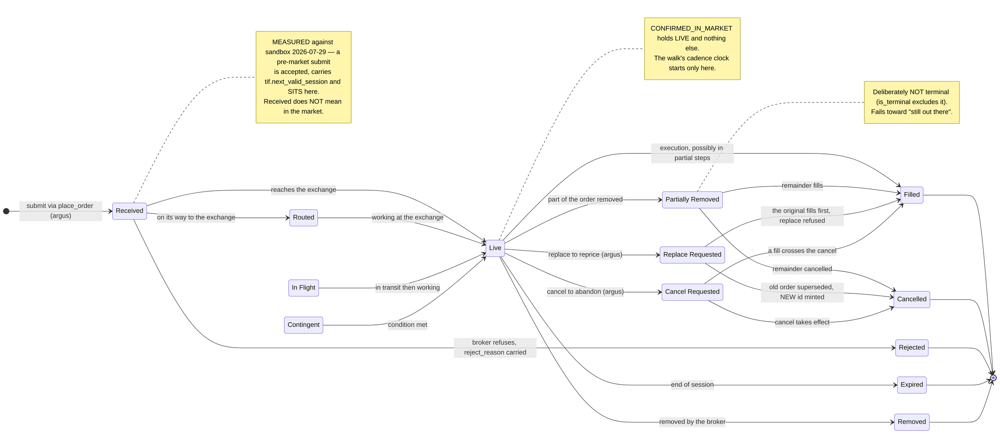
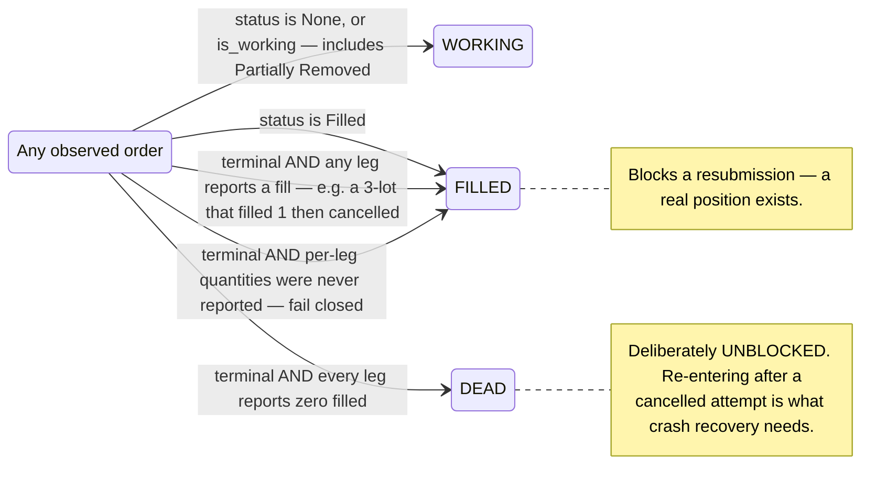
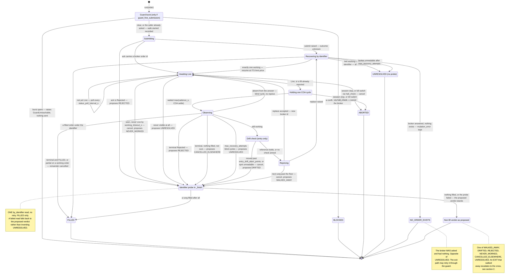
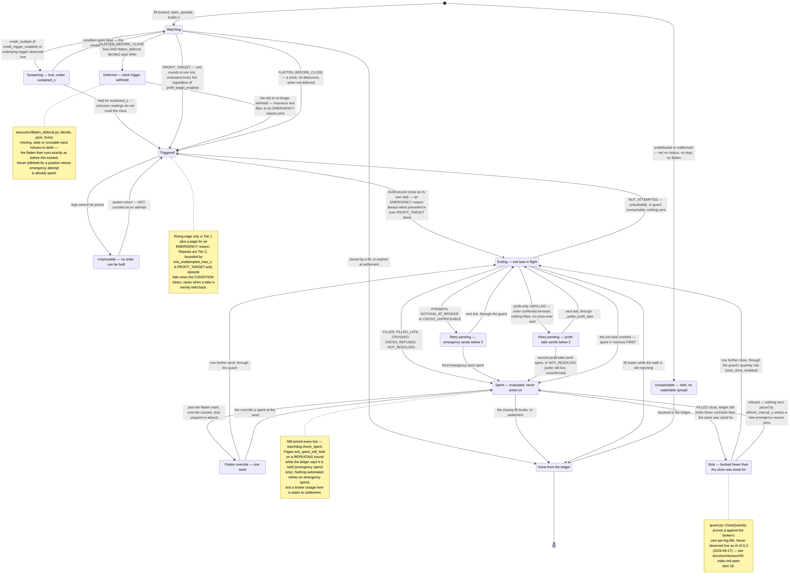
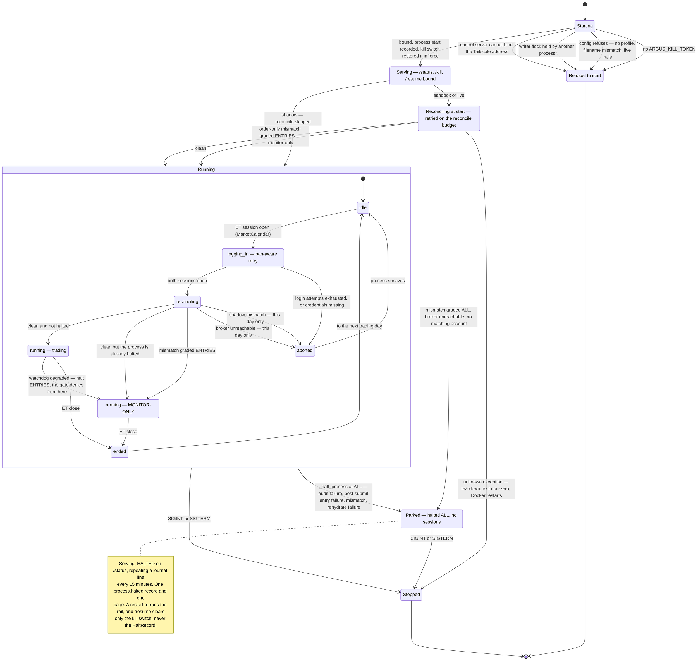
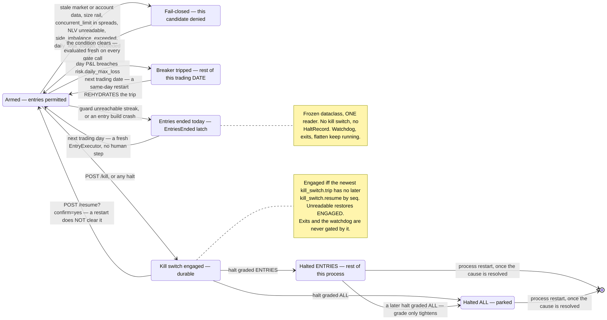

# UML state diagrams — orders, positions and the system

**Audience:** engineers implementing or debugging these flows.

Four things have a genuine state machine in Argus, and they are not the same machine:

1. **An order** has the state tastytrade says it has. Argus observes it and drives only
   three transitions (submit, replace, cancel).
2. **A walk** is Argus's own machine layered on one trade idea's order(s). It decides what
   to do about each observation and ends in one of ten explicit outcomes.
3. **A held position** has an exit lifecycle in the watchdog — watched, triggered, exiting,
   retried, spent — and that lifecycle, not the order's, is what decides whether anything
   automated can still close it.
4. **The system** has operating states (starting, serving, halted and parked, monitor-only)
   plus a set of entry-permission overlays that are flags, not phases.

Keeping them apart matters because most of the interesting logic is one machine reacting to
another, and the classification bridging orders to walks (`classify_order`) is deliberately
three-valued rather than "terminal / not terminal".

---

## 1a. Order lifecycle — the broker's states

`OrderStatus` (`execution/models.py`) mirrors tastytrade's enum value-for-value;
`test_order_status_mirrors_the_sdk_exactly` asserts the value sets are **equal**, so an SDK
that gains a status breaks CI rather than falling through a mapping on a live order. An order
whose status cannot be mapped at all is not dropped: `get_live_orders()` returns it in
`LiveOrders.unmappable`, and reconciliation halts on it.

Only three transitions are initiated by Argus (marked **(argus)**). Everything else is the
exchange or the broker acting, and Argus learns about it by polling `get_live_orders()` or by
an `AlertStreamer` push.

What has been **observed** on real orders, as opposed to drawn from the enum:
`Received → Live → Filled`; `Routed → Rejected` inside a second (2026-08-27, cert's
"Session offline"); a replace minting a new id and leaving the old one `Cancelled`; a
replacement **refused** with *"Received a fill on the original order"* while the original
filled (2026-09-01 — drawn as `REPLREQ → FILLED`, though whether the original's status passed
through `Replace Requested` first was not recorded); a replace of a partially
filled order carrying the **remainder** (2026-09-01); and a `Cancel Requested` going
terminal inside 1.5s.

> **Unverified:** the transitions *into* `ROUTED`, `IN_FLIGHT` and `CONTINGENT`, and their
> exact meanings at tastytrade, have not been observed during regular hours, which is why
> none of them is in `CONFIRMED_IN_MARKET`. An order that **stays** at `Cancel Requested`
> has never been observed either.

### The disposition overlay — what a status *means* to a caller

`classify_order` (`execution/models.py`) is the one classification, shared by the duplicate
guard, order reconciliation, the walk's identifier probe and the exit's settle check, so
they cannot drift.

---

## 1b. The walk — Argus's own machine over one trade idea

`PriceWalkingLoop.run` (`execution/loop.py`) is one state machine used for **both** entry and
exit, parameterized by a `WalkPolicy`. There is no direction branch anywhere in it:
tastytrade's sign convention (positive limit for a credit, negative for a debit) makes
"concede toward the market" a subtraction in both cases. The ladder is arithmetic on the
opening limit — never a re-quote — floored at a percentage (with `exit_walk_min_steps` for
exits) and clamped at the strike width.

Three properties the diagram encodes that the first revision did not:

- **The guard is asked before `walk.started`**, in a bounded burst. A spent burst raises a
  typed `GuardUnreachable` out of `run()` — it is **not an outcome**; the caller sends
  nothing and decides (entry: retire the idea; exit: `NOT_ATTEMPTED`).
- **Every non-fill verdict is probed** (`_finish`, 2026-09-10): before a walk may report
  that a trade idea did not fill, it asks `by_identifier` once, and a FILLED rung anywhere
  under the identifier turns the verdict into `FILLED`. `BLOCKED` and `ABORTED` never ask —
  the latter because a halt must not add a broker round trip. Three sites pass
  `probe=False` because they have just read that exact answer.
- **Every exit from the machine registers a residual** if the last observation of the order
  was still working, so a failed or stuck cancel is rechecked by P5 rather than forgotten.

**Every terminal state is a report, not a guarantee.** A cancel request and a fill can
cross, so `positions` (written by `FillConsumer`) and restart-time reconciliation stay
authoritative about what is held. `WalkResult.filled_contracts` is scoped to one rung;
`positions` is what says what a trade idea filled.

---

## 2. A held position's exit lifecycle — the watchdog's view

This is the machine that decides whether anything automated can still close a position, and
it is where most live incidents have been. The rule it enforces is **one EMERGENCY exit
attempt per position per process** (`_attempted`, never pruned), because a second closing
order on top of one that may still fill closes the spread twice — re-opening it inverted on
expiry day. The exceptions are narrow and each is licensed by `DuplicateOrderGuard` re-asking
the broker, never by elapsed time.

Since v0.5.0 → v0.5.3 (2026-09-23 → 2026-09-27) this machine gained a **non-emergency**
trigger with its own budget (`PROFIT_TARGET`), a **stub continuation** for a partial close
(`_maybe_stub_close`), and a **deferral seam** that can withhold the clock trigger
(`flatten_deferral.py`). None of the three touches the one-emergency-attempt rule: a profit
take that does not fill spends nothing (`_attempted`/`_sends`/`_flatten_attempted` untouched,
AST-pinned), a stub close spends its OWN allowance (`_stub_spent`), and a deferred flatten is
simply a trigger that has not fired yet.

`ExitOutcome.closed` is true only for `FILLED` and `FILLED_LATE`; `CROSSED` means a crossing
limit was *sent*, and the position leaves the watch list when its fill books. `UNFILLED` exists
only on the profit path — `_settle_profit_take` never crosses, so a profit take that finds no
fill simply reports and the next tick may try again, under its own two-send budget
(`_PROFIT_SEND_ATTEMPTS = 2`) separate from the emergency exit's three
(`_EXIT_SEND_ATTEMPTS`). Every other `ExitOutcome` spends the attempt it was reached under —
`ExitReport` is a report too, and the ledger decides when a position is gone.

> **Unverified:** `PROFIT_TARGET` has fired in no live session as of 2026-09-27 (shipped OFF
> at v0.5.0 and v0.5.2); the `STUB` state, the `DEFER` state, and the strike-touch stop's
> `SUST`/`TRIG` path with `credit_trigger_enabled = false` are all drawn from the source and
> its tests, not from an observed live transition. → 00-index.md open items 14–16.

---

## 3. System operational state

The process has three nested lifetimes: the process itself, the scheduler's day loop, and the
session inside a trading day. The halts sit across all three, and **they no longer end the
process**: since 2026-08-17 a halt parks it (still serving `/status`, `/kill` and `/resume`),
and since 2026-08-29 a halt has a width.

The `SessionPhase` values are the real ones published to `/status` (`status.py`); a halt is
reported by `StatusSnapshot.halted`, which sits above the phase and changes what it means.

### Entry-permission overlays

These are not phases — they are flags that decide whether a candidate may become an order
while the system stays in whatever phase it is in. Each has a **different clearing rule**,
which is exactly what `/status` renders them separately for: the operator already knows
entries are off; what they need is what clears it.

> **Verified:** the kill switch has three functional readers, all on the ENTRY side —
> `PreTradeGate.evaluate`, `EntryExecutor.submit`'s pre-build re-check, and the `halt_check`
> the entry executor arms on `PriceWalkingLoop`. `KillSwitch.check()` and `HaltedError`
> still exist but nothing in `src/` calls `check()`. `ExitExecutor` holds no reference to
> the switch (`tests/test_kill_scope.py`), and the residual recheck is deliberately not given
> one either — cancelling an abandoned OPENING order while halted is what the operator asked
> for.
