# The whiteboard — Argus on one page

**Audience:** anyone, first. This is the drawing you would put on a whiteboard before
explaining anything else: the major blocks and how they connect, nothing more. Every block
is a real component and every arrow is a real call or data
flow — the detail behind each lives in files 01–05.

How to read it, left to right: **market data comes in**, the **signal engine** proposes a
spread, the **risk gate** decides whether it may trade, the **entry executor** walks one
multi-leg limit order to the broker, **fills come back** on the account stream into Argus's
own ledger, and the **position watchdog** — a separate, always-running task — watches what is
held and closes it through the same walking engine. Everything writes to the **audit log**
first. The **kill switch** reaches only the entry side, on purpose. The **reconciler** checks
Argus's ledger against the broker at every start.

```mermaid
---
config:
  flowchart:
    useMaxWidth: false
  look: handDrawn
  theme: neutral
---
flowchart LR
    ttmd[("tastytrade<br/>market data")]
    md["Market data +<br/>0DTE chain"]
    sig["Signal engine<br/><small>strategy + blackout</small>"]
    gate{{"Risk gate<br/><small>size, staleness, concurrency,<br/>daily-loss breaker + budget,<br/>side balance</small>"}}
    entry["Entry executor<br/><small>duplicate guard</small>"]
    walk["Price-walking loop<br/><small>entry AND exit</small>"]
    stack["Order stack<br/><small>audit → throttle → broker</small>"]
    ttbr[("tastytrade<br/>broker")]
    fills["Fill consumer"]
    ledger[("Ledger +<br/>positions")]
    wd["Position watchdog<br/><small>strike-touch stop, 15:30 flatten<br/>(deferrable), profit target off</small>"]
    kill{{"Kill switch<br/><small>durable, entries only</small>"}}
    ctl["Control surface<br/><small>/kill /resume /status</small>"]
    phone(["Operator<br/>phone"])
    recon["Reconciler<br/><small>broker is truth</small>"]
    audit[("Audit log<br/><small>hash chain</small>")]
    slack(["Slack"])
    jobs["Nightly jobs<br/><small>snapshot + EOD + trading ledger</small>"]
    nas(["NAS"])
    gsheet(["Google Sheet<br/><small>reconciled to the cent</small>"])

    ttmd --> md --> sig --> gate --> entry --> walk --> stack --> ttbr
    ttbr -- fills --> fills --> ledger --> wd
    wd -- close --> walk
    phone -- Tailscale --> ctl --> kill
    kill -. stops .-> gate
    kill -. stops .-> entry
    recon <-- compare --> ttbr
    recon <-- compare --> ledger
    stack -- record first --> audit
    wd -- alert --> slack
    audit --> jobs --> nas
    jobs -- reconcile vs broker --> gsheet
```

## The six sentences worth remembering

1. **One process, one event loop, one writer** — the watchdog, the signal loop, the streams
   and the kill switch all share it, and only one process may ever write the audit log.
2. **The broker is the only source of truth.** Argus's ledger is what it *expected*; the
   reconciler refuses to trade on any disagreement it cannot explain.
3. **Entry and exit share one walking engine.** What differs is who starts it (the gate vs
   the watchdog), how far it will concede, and that only an exit may escalate to a
   market-crossing limit — capped at the spread's width.
4. **The watchdog is independent of the signal engine** and survives almost everything: a
   kill, an entries-ended day, even its own exception. It is the only thing that can close
   what is held.
5. **The kill switch stops new risk and nothing else.** It survives a restart and is cleared
   only by a confirmed `/resume` — never by a clock.
6. **A halt parks, it does not exit** — `/status` and `/kill` stay reachable through the very
   failures an operator most needs to look at.
