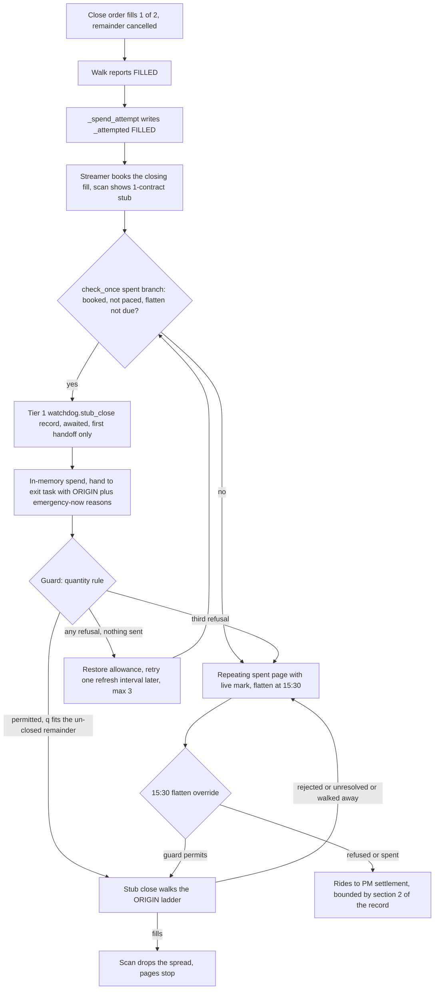

# A quantity-aware guard for CLOSE identifiers — closing the stub a partial close leaves

**Status: BUILT 2026-09-24, REVIEWED AND REVISED THE SAME DAY, TAGGED AS v0.5.1 AND
DEPLOYED at the latest with v0.5.2 (2026-09-26)** — implemented on the v0.5.0 working tree per §10's sequence, then
revised for the twelve findings of the 2026-09-24 code review (§12), full suite
green (2,884 passed), released as v0.5.1 (a COUPLED image + config deploy,
§11). The text below is the design as revised: where the review changed a rule,
the section states the revised rule and §12 records what changed and why. Decision record:
[closing the stub a partial close leaves](../decisions/2026-09-23-closing-the-stub-a-partial-close-leaves.md).
Background: [§12.1 of the profit-target record](../decisions/2026-09-22-profit-target-and-re-entry.md)
(the 2026-09-23 review that made a partial fill spend the close and page).

Standing rules this design lives inside: never write to `argus.db` /
`argus-live.db` (all dev/test on `argus.dev.toml`, reads `mode=ro`); the audit
chain writes before the next action; broker is the only source of truth; every
autonomous send path is bounded and fail-closed.

> **Line numbers** are against the working tree as of 2026-09-24 (v0.5.0,
> `src/` unchanged since). They will drift; the named sites are the anchor.

---

## 1. Recommendation in one paragraph

**Split the fix into two halves that share one invariant.** Half one teaches
`DuplicateOrderGuard.has_conflicting_order()` (private record, not published)
a QUANTITY rule that applies only to CLOSE identifiers: a close of `q`
contracts is permitted iff nothing is WORKING under the identifier, every order
under both the close and the sibling OPEN identifier is readable, and for every
leg symbol `closed_filled + q ≤ opened_filled`, with both sums taken from the
BROKER's own per-leg fill quantities off the one `get_live_orders()` fetch the
guard already makes. Half two gives the stub ONE further close attempt — the
flatten-override precedent made durable: spent at the handoff, recorded at Tier 1
before the send, rehydrated on boot, never re-granted. The watchdog detects the
stub scan-side (a spent FILLED position the ledger still holds), which is
exactly the "the ledger has booked every closing fill" premise the decision
record requires — the guard's inequality then re-proves it against the broker on
every ask. Everything unreadable refuses; nothing is relaxed on the OPEN side;
the entry path is untouched.

Rejected alternatives and residual risks: §8. What deliberately does not change:
§4.5, §5.4.

---

## 2. The state, in source

A closing order fills part of the position. The walk cancels the remainder and
reports `FILLED` — loop.py:1399-1416 (private record, not published)
(*"partial fill; remainder cancelled"*). What is left is a stub, and since the
2026-09-23 review it lands in the state built for it:

- The fill spends the position's close: `_spend_attempt()` (private record, not published)
  writes `_attempted` (private record, not published) (profit takes
  reach it only on a fill, via `_after_profit_take()` (private record, not published)).
- The stub stays in the scan — `OpenSpread.contracts` is
  min of the legs' applied quantities (private record, not published), so
  the booked stub is a smaller spread — evaluated and marked every tick, paged
  every `exit_unattempted_max_s` by `_page_if_spent_and_still_held` from the
  spent branch of `check_once` (private record, not published).
- No automated close of it can ever be sent, for two stacked reasons:
  1. **The watchdog won't try.** `_attempted` silences `_trigger`; only the
     flatten's one-shot override (`_flatten_may_act` (private record, not published))
     can send past it.
  2. **The guard would refuse.** Every close uses the same identifier
     `argus-close-<candidate>`, and the guard BLOCKS on a FILLED disposition
     under the identifier it is asked about
     (`classify_order` (private record, not published): a terminal order
     that partially filled is FILLED) — correctly, for the case it was built
     for: a second close sized from a ledger that has not booked the first fill
     (the measured 4–5s lag) would over-close and re-open the position inverted.

The 2026-09-02 flatten-allowance fix already established the spend/restore
vocabulary for "one further close past a spent attempt"
([design](2026-09-02-flatten-allowance-spent-before-the-order.md)), and the
2026-09-03 exit-guard fix established that the exit path's guard question rides
a bounded burst inside the walk
(`loop._ask_guard` (private record, not published), reached from
`run()`'s (private record, not published) `guard_first_submission=True` —
its one caller in `src/` is the exit path; the entry path asks its own question
in `entry._check_for_duplicate` before the walk, and is untouched by this
design). This design extends both vocabularies; it invents neither.

---

## 3. Why the fix has two halves

The decision record's Candidate A names only the guard. But a guard that would
PERMIT a stub close changes nothing while `_attempted` silences the watchdog —
the stub's stop, backstop and 15:30 flatten override all come back `BLOCKED`
today because nothing sends after the spend. Conversely, a watchdog that sends
into a guard that blocks merely burns allowances. So:

| | Guard only | Watchdog only | **Both** |
|---|---|---|---|
| Emergency stub (exists today) | never sent | sent, refused, allowance burned | **sent once, guard-proven** |
| Profit-take stub (v0.5.0 gate) | never sent | sent, refused | **sent once, guard-proven** |
| Ordinary closes / retries | rule degenerates to today (§4.5) | unchanged | **unchanged** |

The two halves share ONE invariant, and it is the decision record's own
sentence: *`q` from what the ledger holds only once it has booked every closing
fill.* Half two arms the send only from scan-side evidence (the booking);
half one re-proves it against the broker on every ask (the inequality refuses
while `q` overstates). Neither trusts the other; both fail closed.

---

## 4. Half one — the quantity rule in the guard

### 4.1 The rule

The rule runs ONLY when the guard was built with it (`close_quantity_rule`,
armed by `watchdog.stub_close_enabled`, §5.6) AND the binary verdict for a CLOSE
identifier asked **with an intended quantity `q`** is `conflicting_filled_order`
— the stub state. **It only ever CLEARS that refusal; it never refuses an ask the
binary rule allows** (§12, finding 5). There it permits iff ALL of:

1. **Nothing WORKING under the close identifier** — unchanged, and it still
   outranks everything: a working order can still fill, and a second order
   would mean two. (`PARTIALLY_REMOVED`, unknown status: WORKING, as today.)
2. **Nothing unmappable under the close identifier** — unchanged
   (`BLOCKED_UNMAPPABLE` (private record, not published) keeps its reason
   precedence).
3. **Nothing unmappable under the sibling OPEN identifier**
   (`argus-open-<candidate>`, derived by the grammar, §4.4) — new, because the
   opened quantity is now an INPUT, and an order Argus cannot read is an
   unknown input.
4. **Every order under both identifiers reports a SANE per-leg filled
   quantity** — `remaining_quantity` not `None`, and `0 <= filled <=
   leg.quantity`, on every leg of every order, so `leg.filled_quantity` is a
   count, never a guess (§12, finding 7). This includes DEAD orders: a
   cancel-after-partial is DEAD-looking with fills.
5. **For every leg symbol in the union of the two identifier's orders:**
   `closed_filled[symbol] + q ≤ opened_filled[symbol]`.

On any failure of 3–5 the verdict is BLOCKED with a new typed reason — the
guard's own vocabulary, never broker prose:

- `opened_quantity_unreadable` — an unmappable order under the open identifier.
- `close_quantity_unreadable` — any leg anywhere without a `remaining_quantity`.
- `close_quantity_exceeded` — the inequality fails. The verdict payload carries
  the arithmetic (§4.7), because "closed 1 + q 2 > opened 2" is the ledger-lag
  sentence and "closed 2 + q 1 > opened 2" is the double-close sentence, and
  the operator must not have to re-derive which.

When asked about a CLOSE identifier **without** `q`, about any OPEN identifier,
about anything the binary rule allows or refuses for another reason, or on a
guard built without the rule: today's binary rule, byte-for-byte. Fail closed
means the old behavior, not a new guess.

### 4.2 Where the numbers come from — one fetch, already exercised

The rule needs NO new broker round trip. `get_live_orders()` returns
`LiveOrders` (private record, not published) — **all of today's orders for
the account, terminal ones included** (watchdog.py:1910-1912), on a rolling 24h
window (models.py:658-660). The guard already fetches it once
(guard.py:157 (private record, not published)) and filters by identifier;
the quantity rule filters the SAME answer a second time, by the sibling OPEN
identifier. Both sides of the inequality come from the same consistent snapshot.

The data dependency is not novel: `classify_order` (private record, not published)
already reads `reported_fill_quantity` (private record, not published) —
`quantity − remaining_quantity` per leg — off exactly these terminal orders, in
the guard, on every exit ask today. The quantity rule reads the same fields the
classification already trusts; it just does not throw the number away.

The **replace chain** sums correctly, on the one live measurement that exists
(2026-09-01, store.py:165-167): the original filled 1 (cancelled remainder),
the replacement carried the REMAINDER and filled 1, position held 2. Summing
filled across the chain = 2 = opened. That measurement is entry-side; the
close-side chain is the same mechanism, and the rule fails closed if its
quantities are ever not reportable.

**Day scoping is free.** `candidate_id` embeds the trading date
(`candidate_key` (private record, not published)), so yesterday's
identifiers never collide with today's sums even inside the 24h order window.

### 4.3 Per-leg accounting, not per-spread

`Order.contracts` is `min` across legs; `reported_fill_quantity` (private record, not published)
is `max`. Neither is the right reduction for the quantity rule, because legs
can disagree — an uneven partial (1 vs 2) leaves a naked remainder on one side,
which is the single-legged outcome the atomic-submission rail exists to avoid
but which a partial cancel can still produce. The over-close question is
PER-LEG: a close of `q` closes `q` of each leg, so it over-closes exactly when
`q > held[symbol]` for some leg. Hence:

```
allowance = min over symbols in union(open legs, close legs)
            of (opened_filled[symbol] − closed_filled[symbol])
permit    = q ≤ allowance        (and every input readable)
```

For every uniform fill this equals the spread count — the decision record's
`sum(filled close quantity) + q ≤ opened quantity` verbatim. For an uneven one
it is the conservative bound: the binding leg is the one that would invert.
A symbol present in the close set but not the open set has `opened_filled = 0`
and refuses by arithmetic — no special case. A symbol present only in the open
set is covered because the new close order carries both of the spread's legs by
construction (`_build_exit_order` (private record, not published)
builds from the held spread, and `close()`'s candidate-agreement
check (private record, not published) pins the strikes).

### 4.4 The API shape

```python
async def has_conflicting_order(
    self, external_identifier: str, *, quantity: int | None = None
) -> ConflictVerdict
```

- `quantity` is **the contracts the submission would carry**. It participates
  ONLY in the CLOSE rule; the guard parses the direction with
  `parse_external_identifier` (private record, not published) and ignores
  `quantity` entirely for OPEN identifiers (over-opening is the size rails'
  question, not the guard's — the OPEN rule stays binary).
- `quantity <= 0` raises `ValueError` — a close of nothing is a caller bug, and
  the guard's existing empty-identifier refusal is the precedent for failing
  loud at the door.
- The sibling OPEN identifier is derived by the GRAMMAR, in
  `models.py` beside the parser (`sibling_identifier(identifier, direction)`
  built on `ORDER_ID_PREFIX` (private record, not published) and the parsed
  candidate) — never by string surgery in the guard, and never a second minting
  path that could drift from `build.external_identifier` (private record, not published).
  An identifier that does not parse gets no quantity rule (binary behavior).
- **One call-site change**: `loop._ask_guard` (private record, not published)
  passes `quantity=order.contracts` at both of its guard invocations (the
  unbounded path at loop.py:1130 and the burst's inner await at loop.py:1151).
  `_ask_guard` is the exit path's seam — `guard_first_submission=True` has one
  caller in `src/` — so the quantity rule reaches the broker question of exit
  walks only: ordinary closes, `_RETRYABLE_EXITS` retries, the flatten
  override, and (from half two) the stub close. The entry path's own guard
  burst is untouched.

### 4.5 What does not change — the degenerate cases

- **A first close** (nothing under the close identifier) and **a retry after
  a DEAD close** (`NOTHING_AT_BROKER` / `CROSS_UNPRICEABLE`): the binary rule
  ALLOWS, so the quantity rule does not run at all — the verdict is
  byte-for-byte today's. As first built, the rule ran here too and could turn
  an allowed stop, backstop or flatten into a refusal (an opener Argus cannot
  read, an order window no longer showing the opener) that spent the attempt;
  §12, finding 5.
- **A close while an opening-order remainder still works** (the P5 residual
  case): the working OPEN-side order does not block (it is not under the asked
  identifier — true today too) and its filled-so-far counts toward
  `opened_filled`; the close of the BOOKED part is sized from the booked ledger
  and is correct. If the straggler opener later fills, that is the pre-existing
  `held_but_unbooked` page, not a new hazard.
- **The entry path**, `_await_settled`, the cross's positive confirmation,
  `LiveOrders`, `classify_order`, reconciliation: untouched. The cross remains
  subject-of-`walk.broker_order_id`; the FILLED-wide probe stays wide.

### 4.6 Records and the verdict

`ConflictVerdict` gains an additive `quantity` block in `to_payload()`:
`{"asked": q, "opened_filled": {sym: n}, "closed_filled": {sym: n},
"allowance": n}` — on refusals as well as permissions, because the arithmetic
IS the operator's answer.

- **Quantity-permitted close** (a FILLED disposition existed under the close
  identifier and the rule cleared it — the state the binary rule would have
  blocked): **Tier 1, new category `order.duplicate_close_permitted`**. This is
  the inverse of `order.duplicate_blocked` and equally a decision to trade; a
  post-mortem of "why did Argus send a second close" must find the proof in the
  Tier 1 trail, not in Tier 2 telemetry. Volume is bounded by stub frequency —
  rare by construction.
- **Quantity-refused**: Tier 1 `order.duplicate_blocked` as today, with the new
  typed reasons above.
- **Everything else**: `order.duplicate_check` Tier 2 telemetry as today, now
  carrying the quantity block when it was computed.

### 4.7 Fail-closed enumeration (the guard half)

| Input | Reading | Verdict |
|---|---|---|
| nothing FILLED under close id (binary ALLOWS) | nothing to clear | ALLOW, unchanged — the rule does not run |
| guard built without the rule | switch off | binary, unchanged |
| any order under close id WORKING | may still fill | BLOCK (`conflicting_working_order`) |
| any order under close id unmappable | unknown | BLOCK (`conflicting_unmappable_order`) |
| FILLED under close id, any order under open id unmappable | opened unknown | BLOCK (`opened_quantity_unreadable`) |
| FILLED under close id, any leg either side `remaining_quantity is None` or outside `0 <= filled <= quantity` | fill count unknown | BLOCK (`close_quantity_unreadable`) |
| FILLED under close id, no orders under the open id visible | opened = 0 | BLOCK by arithmetic (absence is not a verdict) |
| FILLED under close id, `closed_filled + q > opened_filled` on any symbol | over-close | BLOCK (`close_quantity_exceeded`) |
| broker unreachable | no answer | RAISES, unchanged — the `GuardUnreachable` burst owns the retry, and no submit is reachable without an answered verdict |
| identifier empty / not Argus's / does not parse | caller bug or foreign | `ValueError` / binary rule, unchanged |
| `quantity <= 0` | caller bug | `ValueError` |

The ledger lag needs no row of its own because it IS the over-close row: while
the ledger has not booked the closing fill, `q` overstates held, the inequality
fails, and the verdict names the numbers.

---

## 5. Half two — the stub close

### 5.1 Detection — scan-side, because the ledger is the authority on what is held

In the spent branch of `check_once` (private record, not published),
after the existing mark/page work and BEFORE the flatten check:

```
stub  :=  stub_close_enabled
         and spent.outcome is ExitOutcome.FILLED
         and spent.reasons                    # the origin is known (§5.3)
         and 1 <= spread.contracts < spent.contracts   # the partial BOOKED
         and key not in self._exiting         # no exit task in flight
         and key not in self._stub_spent      # the allowance (§5.2)
         and not (FLATTEN_BEFORE_CLOSE in fired        # past the mark, the
                  and key not in _flatten_attempted)   # flatten goes first
         and not paced (§5.2)                 # a restored retry waits
         and evaluation.market is not None    # an order can be built
```

`spent.contracts` is how many contracts the ledger held when the close that
spent the attempt was HANDED OFF (a new `_SpentAttempt` field). Holding FEWER
now is the decision record's premise — some of the close has BOOKED
(`OpenSpread.contracts` derives from applied quantities) and what is left is the
stub. As first built the condition was `spread.contracts >= 1`, which is equally
true when NOTHING has booked: every close whose fills were still in flight — full
closes included — read as a stub and sent a doomed guarded ask with a false
failed-exit page (§12, finding 4). `filled_contracts` is deliberately NOT
consulted: it is rung-scoped, and the record says the ledger and the broker are
the authorities. The `market is None` case waits for quotes and repeats, like
the ordinary trigger path — evidence, never a timer.

The ledger-lag race (walk reports FILLED, booking 4–5s away, scan still shows
the FULL size) is therefore not asked about at all: the stub condition is false
until the booking lands, and a FULL close then simply leaves the scan. The guard
still re-proves `q` on the ask that does go out, so a partial booking (one leg
applied, the other still in flight) is covered by the arithmetic, not by
timing.

### 5.2 The allowance — the flatten-override precedent, made durable

One further close per stub, per candidate, per process lifetime AND across
restarts:

- **Spent at the handoff, before the send** — the flatten rule
  (watchdog.py:4465 (private record, not published)): a crash between
  handoff and report must not grant a second one. Concretely, in order:
  1. **Tier 1 `watchdog.stub_close` record, awaited, ONCE per stub** — the
     durable spend, written before the FIRST order can go out (the
     audit-before-action rule; an `AuditWriteError` halts, uniformly). A
     re-handoff of the same allowance after a no-send restore adds nothing to
     the durable state and is Tier 2 `watchdog.stub_close_retry` (§12, finding
     1). Payload: `external_identifier` (the POSITION key, which the boot read
     rehydrates from), `candidate_id` at the TOP level (the B1 throttle rule),
     `close_identifier`, `contracts`, `origin_contracts`, `origin_reasons`,
     `handoff_reasons`, and the mark at the moment of the send through
     `payload_number` (§12, finding 11).
  2. In-memory spend: `_stub_spent.add(key)`.
  3. Hand to the exit task.
  A crash after (1) before (3) loses the allowance and keeps paging — the
  fail-closed direction, bounded by §2 of the decision record.
- **Restored in-memory only on the two no-send values**: `NOT_ATTEMPTED`
  (construction refusal or the guard burst exhausted — the sites are lexically
  above the walk, AST-pinned, the flatten precedent verbatim) and a walk that
  ended `BLOCKED` **for any guard reason** — `BLOCKED` is produced at exactly
  one site, the guard's refusal before the first submission (AST-pinned), so it
  PROVES nothing was sent, and a retry re-asks the guard, which re-refuses for
  as long as the cause stands. As first built only `close_quantity_exceeded`
  restored, so the partial's own remainder still at `Cancel Requested` a second
  after the partial (`conflicting_working_order`) spent the one allowance for
  good (§12, finding 3).
- **Every restore is PACED**: the next handoff waits one
  `watchdog.refresh_interval_s`, which also guarantees a rebuilt watch list
  between asks — bypassed only when the handoff gains an EMERGENCY reason the
  last one lacked, since an emergency is never delayed by a stand-down (the
  profit target's rule). As first built a restore re-handed-off on the next
  cadence tick, which wrote a Tier 1 row per tick and, past 15:30, pre-empted
  the flatten forever (§12, finding 1).
- **`BLOCKED` restores are bounded** at `_STUB_BLOCKED_RETRIES = 3` (a module
  constant, deliberately not config): paced, three refusals span ~45s, an order
  of magnitude past a cancel landing (~1.5s) or a fill booking (4–5s). The third
  keeps the allowance spent and pages ONCE (`watchdog.stub_close_exhausted`,
  with the guard's reason); the first two are Tier 2
  `watchdog.stub_close_blocked`. `NOT_ATTEMPTED` restores are unbounded in count
  — evidence-driven, like the emergency path's own — but bounded in rate.
- **All other outcomes keep the allowance spent**: `FILLED`, `NOT_RESOLVED` from
  an order that reached the broker, rejections, crash. The flatten override
  remains available behind it as the 15:30 backstop, exactly as it is for any
  spent position.
- **The durable record is never un-written.** A `NOT_ATTEMPTED` after the
  record leaves a false durable spend: post-restart the allowance reads spent
  and no continuation fires — one further close lost, pages continue, flatten
  backstop intact. This is the flatten precedent's own asymmetry, accepted
  deliberately: the alternative (record after the send) re-grants on every
  crash between send and record, which is the acceptance criterion's named
  hazard.

### 5.3 Which ladder — the ORIGIN's, carried on the spend

`_SpentAttempt` gains two additive fields, `reasons: frozenset[TriggerReason] =
frozenset()` and `contracts: int | None = None` (§5.1), written by
`_spend_attempt` from the report and the handed-off spread. The continuation
hands `_stub_handoff_reasons(origin, fired)` to `ExitExecutor.close`: the
ORIGIN's reasons, plus every EMERGENCY reason firing now, with the profit target
stripped whenever one is present (§12, finding 2). So:

- a **profit-take stub** re-takes on the profit ladder — one tick, two ticks,
  never crosses — while the take is all there is (a refused build is
  `NOT_ATTEMPTED`, restores, retries paced); the moment its stop, the backstop
  or the flatten FIRES it closes on the exit ladder instead, at once. As first
  built it re-took whatever fired, and a one-tick bid on a spread marked at
  twice its credit is never paid — `close()` refuses to build it;
- an **emergency or flatten stub** closes on the exit ladder with its
  width-capped cross.

Re-evaluating triggers "now" would be the tempting alternative and is wrong for
the flatten-origin stub: a winning spread at 15:35 has no stop condition true,
re-evaluation sends nothing, and the flatten's own decision — close before
settlement — is discarded. The close decision was already made; the
continuation executes its remainder.

### 5.4 What the stub path never writes — one budget, named

`_run_exit` gains `stub: bool = False`, and passes it to `ExitExecutor.close`,
whose only use of it is in `_record_exit`: a stub ask the guard refused is
recorded Tier 1 (`watchdog.exit_finished`, now carrying `stub_close`) but NOT
paged, because the watchdog restores and re-asks it and pages once itself on
exhaustion (§12, finding 4). The stub path's report handling (a new
`_after_stub_close`, sibling of `_after_profit_take` (private record, not published)):

- **never writes `_attempted`** — the spent row keeps describing the ORIGINAL
  spend (outcome FILLED, original `since`), which is what the repeating page,
  `/status` and the re-detection condition read. A continuation report that
  overwrote it with `NOT_RESOLVED` would silently disarm the stub state.
- **never writes `_sends`, `_flatten_attempted`, `_profit_spent`** — the stub
  allowance is its only budget. (This keeps the existing AST contract — "a
  profit take reaches `_attempted` only through `_spend_attempt`, only when it
  FILLED" — true with the stub path added, and extends the sweep to name
  `_stub_spent` as the stub path's one write; see §9.5.)
- **pages by outcome through the existing alert kinds** (rejection carries the
  broker's words — the 2026-09-02 rule), each payload gaining `stub_close:
  true` and `candidate_id` at the top level.
- On a crash: the allowance is already spent (handoff), the crash does not
  grant, and `_attempted` is untouched — the original page keeps dating from
  the original partial.

### 5.5 Restart

Boot seeds `_stub_spent` (and `_stub_recorded`) from the audit log: today's
`watchdog.stub_close` rows, keyed by the POSITION identifier each row carries as
`external_identifier` (the grammar's embedded date makes the key day-scoped by
construction — same reason the kill state never needs a date bound, the opposite
of the breaker). The read lives beside the other day-scoped rehydration in
`risk/rehydrate.py`, through the `AuditLog.read` gateway, and returns the raw
keys; the identifier GRAMMAR is applied by the watchdog, which owns it, so
`risk/rehydrate.py` keeps no import from the execution package (AST-pinned) — a
key that does not parse as an opening identifier is treated exactly like an
unreadable row (§12, finding 8).

- **Unreadable** → treat as spent (the kill-state posture: fail closed without
  halting — refusing an extra send is the safe direction, unlike a loss
  budget) and page once.
- **Post-restart, `_attempted` is empty** — the ordinary trigger path may close
  the stub on its own ordinary attempt, and the guard's quantity rule is what
  makes that safe. This is the existing restart semantics for every held
  position (the one-attempt rule is in-process by design; the broker-facing
  guard is the bound), now extended truthfully to the stub. The durable
  allowance exists so a crash loop cannot stack a SECOND, allowance-backed
  send on top of that ordinary attempt every cycle — the acceptance
  criterion's "no fresh budget".

### 5.6 Config

`watchdog.stub_close_enabled` — **REQUIRED strict bool, `true` in all three
profiles.** A new autonomous send path ships behind a switch on the
`profit_target_enabled` / `unmanaged_order_cancel` precedent, and the switch
buys a config-only rollback (flip to `false`, restart; already-sent orders are
unaffected). The cost is a COUPLED image + config deploy (all three profiles +
the `test_config_profiles.py` allowlist) — named deliberately in §11. **The
switch arms BOTH halves**: `pipeline.build_execution_stack` builds the one
`DuplicateOrderGuard` with `close_quantity_rule=config.watchdog.stub_close_enabled`
(AST-pinned). As first designed the guard rule took no flag, on the argument
that it "only ever refines a refusal" and "is inert without a sender" — but the
flatten override and every exit retry ARE senders, so `false` left a permission
live that the rollback claimed to remove (§12, finding 6).
Shipping `true` (not `false`-then-promote) because the emergency-stub exposure
exists TODAY with the profit target off, and the gate this design discharges
is the profit target's promotion.

---

## 6. The flow, end to end



---

## 7. Acceptance criteria, answered one by one

The decision record's §5, in order:

1. **Never over-close.** The inequality is exactly `q ≤ broker-held`, computed
   per leg from the broker's own fill counts: `closed_filled + q ≤
   opened_filled` ⟺ `q ≤ opened_filled − closed_filled` = what the broker's
   order ledger says is still open. A lagging ledger makes `q` TOO BIG, which
   REFUSES (the lag is the over-close row of §4.7, not a silent pass). A
   ledger that under-states held under-closes — safe, and it pages.
2. **Never double-close.** WORKING under the identifier still blocks, with its
   existing precedence over the whole quantity rule; the straggler remainder at
   `Cancel Requested` is exactly that. Nothing may send while any order under
   the identifier could still fill — unchanged, and the stub continuation is
   subject to it like every close.
3. **Fail closed on every unreadable input.** §4.7 enumerates them; the stub
   state (paged, unsent) is the default and every refusal returns to it.
4. **Survives a restart.** The allowance is Tier 1 and rehydrated (§5.5);
   unreadable reads fail toward spent. The ordinary post-restart attempt is
   bounded by the guard, as it is for every held position.
5. **Bounded — one further close attempt per stub, on the flatten-override
   precedent.** Spent at the handoff, restored only on proven-no-send values,
   never re-granted in-process or across restarts. A stub-of-a-stub (possible
   only above minimum size) gets no second allowance — the bound is per
   candidate per day, named deliberately.
6. **Tested end to end on the real executor and guard with a partial fill.**
   §9.4. `test_the_guard_really_blocks_a_close_after_a_partial_take` is updated
   deliberately (§9.1), not deleted — its docstring already says what to do
   when the guard learns to size a close.
7. **Measured first: replace-on-partial for a multi-leg CLOSE, in live, before
   D.** That measurement gates Candidate D, not A — A does not depend on
   replace semantics; it sums what the broker reports either way. A is also
   the more general half: D would reduce how often the stub state is reached;
   A closes the stubs that remain, from any path, including D's own leftovers
   ("it does not help a remainder that then walks away or times out"). The
   record's recommended gate — "resolve this, at least candidate D, before
   `profit_target_enabled = true` in live" — is discharged by A.

And the three "why not a one-liner" constraints of §3: the guard is not
loosened but made quantity-proven (this is the relaxation's own design pass,
with mutation tests); the identifier grammar is untouched (no
generation-suffixed closes — Candidate C stays rejected); `filled_contracts`
is not consulted anywhere in the design.

---

## 8. Residual risks, and what is deliberately not fixed

1. **The C5 manual-close inversion race — pre-existing, inherited, not
   worsened.** An operator who manually closes the stub at the broker leaves
   the ledger holding a phantom; the guard's sums are identifier-scoped and
   cannot see a manual order, so a later close would face a flat book. This is
   precisely the flatten's existing exposure (the 15:30 override sends into
   the same race today), and the mitigations are the ones the SOP already
   names: the dedicated-account non-negotiable, and the SOP's load-bearing
   step — check the broker before sending anything by hand. The design's
   addition is that the continuation fires ONCE within seconds of the partial
   (typically long before a human acts), and the spent page now carries the
   stub state so the operator knows Argus still counts the position as held.
   Naming it here because the quantity rule is the first change that makes
   Argus's post-partial sends routine.
2. **The durable-spend/not-attempted asymmetry** (§5.2): a construction
   refusal after the Tier 1 record permanently spends the allowance for the
   day. Cost: one further close, pages continue, flatten backstop remains.
   Accepted over the crash-loop alternative.
3. **A booking failure lands in the spent state** after three quantity
   refusals. The alternative — unbounded re-asks — is the trail-storm shape
   the repo has rejected three times.
4. **NOT_RESOLVED partials get no continuation** (scope: the stub as defined —
   a walk-confirmed FILLED). A crash or unresolved exit that in fact partially
   filled is an unmeasured state; its close stays blocked by the binary rule
   (no `q` proven) and paged. If live evidence ever shows it, it is a follow-up
   decision, not a quiet widening.
5. **Candidate D is not subsumed**: walking the remainder would prevent most
   stubs from existing. Complementary, gated on its own live measurement.
6. **No DB migration.** The allowance is audit-log state, not a table;
   `positions`/`orders`/`order_legs` are untouched; `scripts/check_migrations`
   has nothing to check.
7. **The rule reads `remaining_quantity` in the PERMISSIVE direction** (§12,
   finding 7). `classify_order` only ever used a fill count to BLOCK, so a
   count reported too high cost a missed trade; here an opener's count too high
   or a closer's too low would ADD capacity. The standing evidence is that the
   ledger books every fill from this same field, diffed per order, and has
   reconciled clean through cert's many replaced walks — but the CLOSE-side
   replace chain has never been observed in live. Mitigated, not removed: a
   count outside `0 <= filled <= leg.quantity` refuses as unreadable; the rule
   runs only where a FILLED close already exists (so it cannot touch an
   ordinary first close); and the switch rolls it back. **The first live
   `order.duplicate_close_permitted` should be read against the broker's own
   confirmations by hand.**
8. **A stub whose partial never books is never continued.** Detection needs
   booked evidence (§5.1); a streamer that never books the partial's fill
   leaves the position on the spent page and the 15:30 flatten — the
   fail-closed direction, and the same exposure the ledger already has for
   every fill it does not book.

---

## 9. Test plan

All development runs on `argus.dev.toml`; no test touches either production DB.

### 9.1 The guard — `tests/test_order_guard.py`

1. **Stub close permitted**: opened 2 (one FILLED open order, both legs
   `remaining_quantity=0`), close order FILLED with 1 of 2 per leg, nothing
   working, `q=1` → `blocked is False`; payload carries
   `opened_filled={s:2,l:2}, closed_filled={s:1,l:1}, allowance=1`.
2. **Over-close refused (the lag)**: same world, `q=2` → blocked,
   `close_quantity_exceeded`.
3. **Double-close refused**: close filled 2 of 2, `q=1` → blocked.
4. **Exact remainder after booking**: closed 1, `q=1`, opened 2 → permitted
   (equality is the working case, not an edge).
5. **DEAD-with-fills counts**: a CANCELLED close order with 1 filled per leg
   contributes 1 (cancel-after-partial).
6. **Replace chain sums**: original filled 1 + replacement filled 1 →
   `opened_filled = 2` (the measured 2026-09-01 shape).
7. **Uneven legs bind on the min**: opened (2,2), closed (1,2) → allowance 0 →
   any `q ≥ 1` refused.
8. **Unreadable close leg** (`remaining_quantity None` anywhere under either
   identifier) → `close_quantity_unreadable`.
9. **Unmappable under the OPEN identifier** → `opened_quantity_unreadable`
   (a NEW block the current guard does not take).
10. **No open orders visible** → refused by arithmetic.
11. **WORKING / unmappable under the close identifier** still block, reason
    precedence unchanged — the existing tests, unedited.
12. **CLOSE without `q`** → binary rule (the existing FILLED-blocks tests
    remain green, unedited — they are the fail-closed default).
13. **OPEN with `q`** → ignored, binary rule.
14. **`q <= 0`** → `ValueError`; empty identifier → `ValueError` (existing).
15. **Broker unreachable** → raises; the `GuardUnreachable` burst in
    `loop._ask_guard` is unchanged and now carries `quantity` through.
16. **Records**: quantity-permitted → one Tier 1 `order.duplicate_close_permitted`
    with the math; quantity-refused → Tier 1 `order.duplicate_blocked` with the
    typed reason; plain checks → Tier 2 as today.

### 9.2 Mutation tests — the record demands them for this module

Each mutant must be KILLED by the suite above (this is the "own design pass and
mutation tests" clause):

| Mutant | Killed by |
|---|---|
| `None` remaining treated as 0 | T8 |
| per-leg `min` → `max` | T7 |
| `≤` → `<` (equality refused) | T4 |
| `≤` → nothing (inequality dropped) | T2, T3 |
| open-identifier unmappable check removed | T9 |
| quantity rule applied to OPEN identifiers | T13 + the entry suite |
| sibling identifier built by concatenation that drops the candidate dashes | T1/T6 with a multi-dash candidate |
| DEAD orders skipped from `closed_filled` | T5 |
| `quantity` defaults to something non-`None` | T12 (the binary default must fail loudly back to old behavior) |

### 9.3 The watchdog — new `tests/test_stub_close.py`

1. **Detection to send**: spent FILLED sized 2, scan holds 1, market present → exactly
   one `_run_exit(stub=True)` handoff with the ORIGIN reasons; Tier 1
   `watchdog.stub_close` written BEFORE the handoff (assert record-before-call
   ordering on the recording fake).
2. **Profit-origin uses the profit ladder** while nothing else fires (no
   cross, `close()`'s profit guards engaged) and **the exit ladder, at once,
   when its stop fires**; **emergency-origin uses the exit ladder**.
3. **Bounded**: after the send, further ticks page and never hand off again.
4. **`NOT_ATTEMPTED` restores**, paced one refresh interval, the Tier 1 row
   written once; past 15:30 the flatten goes first. **Any `BLOCKED` restores**,
   paced — the working remainder included — and the THIRD refusal stays spent
   and pages once (§12, findings 1 and 3).
5. **The flatten override remains available** after an exhausted stub.
6. **The stub path never writes** `_attempted` / `_sends` /
   `_flatten_attempted` / `_profit_spent` — direct state assertions plus the
   AST sweep (§9.5).
7. **A filled continuation drops the spread from the scan** and the spent page
   stops.
8. **Restart rehydration**: a `watchdog.stub_close` row for today's identifier
   seeds the allowance spent; no row leaves it available; an unreadable read
   fails toward spent with one page; a YESTERDAY-date identifier does not
   collide (grammar day-scoping).
9. **`stub_close_enabled = false`**: no handoff, no record — the state is
   exactly today's, and the existing profit-target stub tests pass unedited
   except the send-count assertions below.
10. **Ledger lag**: spent FILLED with the scan still showing the full size →
    NO handoff (nothing has booked); a full close then leaves the scan, a
    partial shows the stub and is continued (§12, finding 4).

### 9.4 End to end — the acceptance criterion

On the REAL `ExitExecutor` + `DuplicateOrderGuard` + `PriceWalkingLoop` +
`FakeOrderExecution` (the `test_the_guard_really_blocks_a_close_after_a_partial_take`
harness shape, `tests/test_profit_target.py:506` (private record, not published)):

- **Happy path**: opening order FILLED 2; take fills 1 (`broker.on_poll`
  partial), remainder cancelled, walk FILLED, ledger books, scan shows the
  1-contract stub, continuation closes it → the position is FLAT and the
  pages stop. Assert the guard's two verdicts in the trail: the continuation's
  `order.duplicate_close_permitted` with `allowance=1`.
- **The inversion guard**: the same world, but the scan fed a stale 2-contract
  spread → `close_quantity_exceeded`, no order, pages continue.

**Deliberate update, not deletion**: `test_the_guard_really_blocks_a_close_after_a_partial_take`
becomes the permission pin (permitted at `q=1`, refused at `q=2`), and
`test_a_filled_take_spends_the_close_so_a_partial_stub_is_paged_not_orphaned`
(`tests/test_profit_target.py:473` (private record, not published)) has its
`len(executor.calls) == 1` assertion move to `== 2` — one take plus ONE stub
continuation, once the partial books — with the docstring rewritten from
"nothing is sent into a guard that will block it" to "one further close, then
pages". The permission pin also keeps the ORIGINAL assertion under
`stub_close_enabled = false`: the booked stub's close is BLOCKED on the fill.

### 9.5 Structural and seam tests

- **AST sweeps**: the profit-path allowance contract extended to name the stub
  path's single write (`_stub_spent`); the `NOT_ATTEMPTED`-sites-lexically-above-
  the-walk pin extended to the stub restore sites; the guard's `quantity`
  parameter asserted absent from every non-`loop._ask_guard` call path.
- **The status seam**: `SpentExitAttempt` / `UnclosablePosition` gain
  `stub_close` state (`available` / `sent` / `exhausted` / `disabled`); the
  `_to_unclosable` (private record, not published) converter sweep test (the 2026-09-02
  under-copy rule) names the new field or fails.
- **Payload safety**: every new alert dict and audit payload goes through the
  `carries_payload` / `to_payload` sweep — the stub pages carry `candidate_id`
  at the top level, and all quantities are ints (never floats, never `None`
  unguarded in a record that decides on them).
- **Config**: `test_config_profiles.py` allowlists the new key; a
  strict-bool refusal test; all three profile files load.

---

## 10. Implementation sequence

Ordered so every step is independently green:

1. `models.py`: `sibling_identifier` beside the parser (+ round-trip test). No
   behavior change.
2. `guard.py`: the quantity rule, verdict payload, reasons, records — with the
   full §9.1/§9.2 suite. Binary behavior untouched (existing tests unedited).
3. `loop.py`: `_ask_guard` passes `quantity=order.contracts` (two lines). Exit
   walks only; entry suite green by construction.
4. `watchdog.py`: `_SpentAttempt.reasons`; `_stub_spent`; detection in the
   spent branch; `_run_exit(stub=)` + `_after_stub_close`; restores and their
   bound. §9.3 suite.
5. `risk/rehydrate.py`: the boot read + seeding; §9.3.8.
6. `config.py` + the three profiles + `test_config_profiles.py`.
7. `status.py` / `session.py`: the spent row's stub state + seam sweep.
8. The §9.4 end-to-end pair and the two deliberate test updates.
9. AST sweeps and payload-safety extensions.
10. Docs (§11), then the pre-deploy read-back: the whole suite plus
    `tools.desk` on the dev DB — read-only, `argus.dev.toml`, never the bare
    command.

Step 2 alone is shippable value (it makes the flatten's and the retries'
post-partial asks quantity-proven); steps 4–5 are the autonomous half and ship
together behind the flag.

---

## 11. Deploy class and documentation owed

- **COUPLED image + config** (one new REQUIRED key, all three profiles). The
  config diff IS half the release; `argus-deploy.sh` will classify and
  fingerprint it. Rollback: image rollback PLUS config revert — or, for the
  behavior alone, `stub_close_enabled = false` as a config-only release.
- **Docs**: one current-state sentence + pointer in `CLAUDE.md`; the decision
  record's status moves from "SPEC, DESIGN AND BUILD OWED" to designed/built
  with this file linked, and its §6 gate marked discharged on the profit
  target; `docs/decisions/README.md` open-questions list; `README.md` and the
  operator cheatsheet — the stub page's meaning changes from "Argus can never
  close this" to "Argus has one further close; `STUB CLOSE: sent` on
  `/status` means it is spent"; the C5 SOP cross-reference in
  `docs/go-live-findings.md` gains the manual-close race note from §8.1.
- **Release notes** on the v0.5.x pattern; the name is unspent.

**The one-sentence version for the release notes:** the duplicate guard now
permits a close of `q` contracts when the broker's own fills prove `q` fits
what is still held, and a partial close's stub gets exactly one further close
— recorded before the send, restored only when nothing was sent, and re-read
from the log on every boot.

---

## 12. The 2026-09-24 code review — what changed, and why

A review of the build as first written found twelve defects; all twelve are
fixed in the build, each pinned by a test that FAILS when the fix is reverted
(twelve mutants, twelve kills). Earlier sections state the revised rules; this
table is the index.

| # | Finding | Fix | Pinned by |
|---|---|---|---|
| 1 | A continuation that kept coming back `NOT_ATTEMPTED` re-handed-off every tick: a Tier 1 row per tick, and past 15:30 it returned before `_flatten_may_act` was reached — **the flatten never ran** (probe: 40 ticks, 0 flatten sends) | Tier 1 row ONCE per stub (`_stub_recorded`; re-handoffs Tier 2); every restore PACED one `refresh_interval_s`; past the mark the continuation YIELDS to the flatten's unspent allowance | `test_not_attempted_restores_paced_and_records_tier1_once`, `test_the_continuation_never_starves_the_flatten`, `test_the_continuation_resumes_once_the_flatten_override_is_spent` |
| 2 | A profit-origin stub re-took on the profit ladder even with its stop firing; `close()` refuses a take whose mark is not one tick, so it could never close, and fed #1 | `_stub_handoff_reasons`: origin plus every emergency reason firing now, profit stripped when one is present; the pacing is bypassed when an emergency reason newly appears | `test_a_profit_origin_whose_stop_fires_closes_on_the_exit_ladder`, `test_the_handoff_reasons_are_the_origin_plus_what_is_urgent_now`, the profit-target stub test |
| 3 | The one allowance was spent by the partial's own remainder still at `Cancel Requested` (the remainder cancel is best-effort; the walk reports FILLED without confirming it) — `conflicting_working_order` kept the allowance spent | Restore on ANY `BLOCKED` walk (produced only by the guard, before any submit — AST-pinned), paced, bounded at `_STUB_BLOCKED_RETRIES = 3`, one `watchdog.stub_close_exhausted` page on the last | `test_a_working_block_restores_paced_and_bounded`, `test_the_third_block_keeps_it_spent_and_pages_once`, `test_only_one_walk_outcome_is_blocked_and_it_precedes_any_submit` |
| 4 | Detection (`contracts >= 1`) fired on every close whose fills had not booked — FULL closes included — sending a doomed guarded ask and a false `watchdog_exit_not_resolved` page; the refusal bound counted cadence ticks (~3s) where the comment reasoned refresh cycles (~45s) | Detection requires `spread.contracts < spent.contracts` (the new `_SpentAttempt.contracts`); a stub ask the guard refused is recorded but not paged by the executor (`close(stub=True)`); the bound is on paced asks | `test_an_unbooked_close_is_not_a_stub`, `test_end_to_end_a_pending_remainder_blocks_the_stub_ask_unpaged`; and the whole suite passes with the switch ON by default |
| 5 | The guard's rule also ran on asks the binary rule ALLOWS, so a first close could now be refused (unreadable opener, opener not visible) — spending the stop's attempt, against §5.6's own "only ever refines a refusal" | The rule runs only when the binary verdict is `conflicting_filled_order` | `test_the_rule_never_refuses_what_the_binary_rule_allows`, T4/T10/T16 |
| 6 | `stub_close_enabled = false` did not roll back the guard permission, which the flatten override and every exit retry still reached | `DuplicateOrderGuard(close_quantity_rule=...)`, default off, armed from the switch in `pipeline.build_execution_stack` | `test_a_guard_built_without_the_rule_is_binary_byte_for_byte`, `test_the_trading_session_arms_the_rule_from_the_stub_switch`, the off-switch half of `test_the_guard_sizes_a_close_after_a_partial_take` |
| 7 | The rule trusts `remaining_quantity` in the permissive direction | Per-leg sanity bound `0 <= filled <= leg.quantity`; recorded as residual risk §8.7 | `test_a_fill_count_outside_the_leg_size_is_unreadable` |
| 8 | `risk/rehydrate.py` imported `argus.execution.models`, falsifying the watchdog's import comment | The rows' raw position keys are returned; the watchdog applies the grammar and fails toward spent on a key it cannot parse | `test_the_rehydrate_module_imports_nothing_from_execution`, the parametrised unreadable-boot test |
| 9 | `_PROFIT_REJECTED`'s doc comment sat above `_STUB_UNATTEMPTED` | Moved | — |
| 10 | `_STUB_UNATTEMPTED` never fell, so a second episode was silent | Falls when a continuation reaches the guard | `test_the_unattempted_page_falls_so_a_new_episode_pages_again` |
| 11 | The Tier 1 record wrote raw `cost_to_close`/`credit_stop`/`spot` | Through `payload_number` | `test_a_non_finite_mark_never_reaches_the_tier1_record` |
| 12 | A bare `assert` in production code; `live: Any` | `_quantity_rule_inputs` returns the typed inputs; `live: LiveOrders` | the guard suite |

**What did NOT change:** the one-attempt rule, the flatten override's
spend/restore, `_attempted` never being written by the stub path, the entry
path, the durable-spend-before-send ordering, and the guard's precedence
(WORKING and unmappable under the close identifier still outrank everything).

